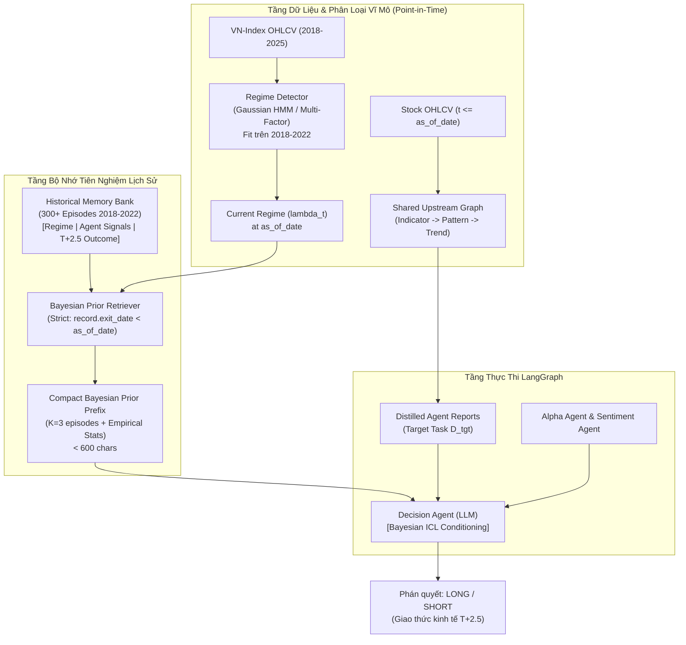

# KẾ HOẠCH NGHIÊN CỨU & TRIỂN KHAI KHÓA LUẬN TỐT NGHIỆP (10 TUẦN)

**Đề tài**: *Regime-Aware Multi-Task Bayesian In-Context Learning for Multi-Agent LLM Stock Trading in the Vietnamese Stock Market*  
**Dựa trên nền tảng**: Bài báo *Multi-Task Bayesian In-Context Learning* (Zhu, Oermann, Cho — ICML 2026) và Hệ thống Giao dịch Đa Agent LangGraph hiện có.  
**Mục tiêu tài liệu**: Giữ deadline **10 tuần**, điều chỉnh ngày **16/10/2026** sau kết quả development chưa đủ tốt. Giữ W1–W6 và W7-01–12; dùng phần còn lại W7 để chẩn đoán/khóa phạm vi, W8 cải tiến Bayesian ICL và validation, W9 benchmark kết hợp thống kê, W10 luận văn và bảo vệ. Không kéo dài lịch; thu hẹp số thử nghiệm, không giảm các gate liêm chính dữ liệu.

**Quy tắc đọc bản điều chỉnh:** mục 5.5, Phase D mới của W7 và README W8–W10 là kế hoạch đang hiệu lực. Các đoạn nghiệm thu W1–W7-12 giữ như lịch sử; tham chiếu benchmark W8 trong các đoạn đó là lịch cũ. Không sửa bằng chứng, registry, selection hoặc checkpoint đã khóa.

**Cách thực hiện từ 09/10/2026:** bỏ bước dự toán ngân sách và lịch chạy
API. Ngày dữ liệu/cohort, cỡ mẫu và protocol nghiên cứu vẫn phải khóa trước
run. Mọi thao tác dùng API key do người dùng tự chạy theo hướng dẫn từng
bước; agent chuẩn bị code/plan, kiểm offline và đối chiếu kết quả được lưu.
Các guard token/quota, cooldown, ledger, checkpoint và đối soát unknown
tiếp tục áp dụng trong runtime.

---

## MỤC LỤC
1. [Bối cảnh & Mục tiêu Nghiên cứu](#1-bối-cảnh--mục-tiêu-nghiên-cứu)
2. [Cơ sở Lý thuyết & Ánh xạ từ Paper Gốc](#2-cơ-sở-lý-thuyết--ánh-xạ-từ-paper-gốc)
3. [Kiểm toán Hiện trạng Repository (System Audit)](#3-kiểm-toán-hiện-trạng-repository-system-audit)
4. [Kiến trúc Hệ thống Đề xuất (Target Architecture)](#4-kiến-trúc-hệ-thống-đề-xuất-target-architecture)
5. [Thiết kế Thực nghiệm Khoa học Chuẩn KLTN](#5-thiết-kế-thực-nghiệm-khoa-học-chuẩn-kltn)
6. [Các Rào chắn P0 Bắt buộc (Safeguards & Zero-Leakage)](#6-các-rào-chắn-p0-bắt-buộc-safeguards--zero-leakage)
7. [Kế hoạch Thực hiện Chi tiết 10 Tuần (Deliverables Matrix)](#7-kế-hoạch-thực-hiện-chi-tiết-10-tuần-deliverables-matrix)
8. [Danh mục Tệp tin Cần Thêm Mới & Chỉnh Sửa](#8-danh-mục-tệp-tin-cần-thêm-mới--chỉnh-sửa)
9. [Kế hoạch Quản trị Rủi ro & Dự phòng (Contingency Plans)](#9-kế-hoạch-quản-trị-rủi-ro--dự-phòng-contingency-plans)

---

## 1. BỐI CẢNH & MỤC TIÊU NGHIÊN CỨU

### 1.1. Tính cấp thiết của đề tài
- **Thách thức của LLM trong giao dịch định lượng**: Các mô hình ngôn ngữ lớn (LLMs) khi được triển khai trong kiến trúc đa agent (Multi-Agent Trading) thường đưa ra quyết định ở dạng suy luận độc lập không điều kiện (Zero-Shot Unconditioned Reasoning). Khi thị trường chứng khoán Việt Nam chuyển pha mạnh mẽ (Regime Shift) — từ Uptrend thanh khoản cao sang Downtrend sụp đổ hoặc Sideway giằng co — các agent thị giác (Pattern, Trend) liên tục gặp bẫy giá (Bull/Bear Trap), trong khi các chỉ báo kỹ thuật (RSI, MACD) rơi vào trạng thái quá bán/quá mua kéo dài.
- **Giải pháp từ Paper ICML 2026**: Công trình của Zhu, Oermann và Cho (2026) chứng minh rằng việc đưa các tập dữ liệu phụ trợ làm **tiền tố ngữ cảnh (In-Context Prefix)** cho phép transformer thực hiện **suy diễn Bayes phân cấp (Amortized Hierarchical Bayesian Inference)**. Điều này cho phép người dùng điều khiển được phân phối tiên nghiệm (controllable prior) ở test-time mà **không cần fine-tune trọng số**, đồng thời mang lại sự ổn định vượt trội trong môi trường ít dữ liệu hoặc phân phối bị dịch chuyển.
- **Mục tiêu KLTN**: Thích ứng mô hình toán học này vào thị trường chứng khoán Việt Nam bằng cách xem:
  $$\text{Chế độ thị trường vĩ mô (Market Regime)} \iff \text{Siêu tham số tiên nghiệm } \lambda$$
  $$\text{Các chu kỳ giao dịch lịch sử trong quá khứ} \iff \text{Các nhiệm vụ tiên nghiệm } D^{(k)}_{\text{prior}}$$
  $$\text{Cửa sổ giao dịch hiện tại} \iff \text{Nhiệm vụ mục tiêu } D_{\text{tgt}}$$
  nhằm kiểm chứng liệu thông tin lịch sử theo regime có giúp Decision Agent
  ra quyết định kinh tế $T+2.5$ tốt hơn. Bản v1 hiện là ICL có lọc regime và
  tỷ lệ mẫu; chưa chứng minh LLM thực hiện posterior Bayes phân cấp hay
  confidence được hiệu chuẩn. W5–W7 bổ sung thống kê Bayes số học, kiểm
  chất lượng prior và đo đóng góp từng thành phần trước khi kết luận.

### 1.2. Giới hạn phạm vi (Scope Boundary for KLTN)
- **Không thương mại hóa**: Không xây dựng hệ thống đặt lệnh tự động thực tế (broker API gateway), không mô phỏng sổ lệnh khớp liên tục (order book L2/L3), không giao dịch phái sinh/bán khống.
- **Phạm vi dữ liệu**: Tập trung vào dữ liệu Daily EOD (End-Of-Day) của VN-Index và 4 cổ phiếu đại diện các nhóm ngành lớn; tận dụng cache tin tức CafeF có sẵn.
- **Phạm vi hạ tầng**: Khai thác mô hình LLM hosted qua Groq API (giữ nguyên stack hiện tại) kết hợp giải pháp nén token chặt chẽ; chạy thực nghiệm có checkpointing để chống quá tải quota.

---

## 2. CƠ SỞ LÝ THUYẾT & ÁNH XẠ TỪ PAPER GỐC

### 2.1. Tóm tắt mô hình toán học của Paper (Zhu et al. 2026)
Trong bài toán suy diễn tiên nghiệm phân cấp:
1. **Mức tập (Episode-level)**: Rút siêu tham số $\lambda \sim p(\lambda)$ từ phân phối meta-prior. $\lambda$ tham số hóa phân phối tiên nghiệm $p(w \mid \lambda)$ của các tham số ẩn $w$.
2. **Mức nhiệm vụ (Task-level)**: Rút độc lập $K+1$ tham số tác vụ $\{w^{(k)}\}_{k=1}^{K+1} \sim p(w \mid \lambda)$.
   - $K$ tác vụ đầu sinh ra $K$ tập dữ liệu phụ trợ: $D_{\text{prior}} = \{D^{(1)}, \dots, D^{(K)}\}$ với $D^{(k)} = \{(x^{(k)}_m, y^{(k)}_m)\}_{m=1}^M$.
   - Tác vụ thứ $K+1$ là tác vụ mục tiêu: $D_{\text{tgt}} = \{(x_j, y_j)\}_{j=1}^{t-1}$ và điểm truy vấn $x_t$.
3. **Phân phối dự báo hậu nghiệm (PPD)**:
   $$p(y_t \mid x_t, C_{t-1}, D_{\text{prior}}) \propto \int p(\lambda) d\lambda \left[ \int p(y_t \mid x_t, w_{\text{tgt}}) \prod_{j=1}^{t-1} p(y_j \mid x_j, w_{\text{tgt}}) p(w_{\text{tgt}} \mid \lambda) dw_{\text{tgt}} \right] \prod_{k=1}^K \left[ \int p(w^{(k)} \mid \lambda) \prod_{m=1}^M p(y^{(k)}_m \mid x^{(k)}_m, w^{(k)}) dw^{(k)} \right]$$
4. **Cơ chế tiền tố (Prefix Mechanism)**: Đưa toàn bộ $D_{\text{prior}}$ vào chuỗi ngữ cảnh:
   $$\langle\text{prior}\rangle D^{(1)} \dots \langle\text{prior}\rangle D^{(K)} \langle\text{target}\rangle (x_1, y_1), \dots, (x_{t-1}, y_{t-1}), x_t$$
   Transformer học cách trích xuất thông tin tiên nghiệm từ $D_{\text{prior}}$, cho phép thay đổi $D_{\text{prior}}$ ở thời điểm suy luận để điều khiển phân phối dự báo.

### 2.2. Ma trận Ánh xạ (Mapping Matrix) sang Giao dịch Chứng khoán

| Thành phần trong Paper (Zhu et al. 2026) | Thực thể tương đương trong KLTN Stock Trading | Hiện thực kỹ thuật trong Repository |
| :--- | :--- | :--- |
| **Meta-distribution $p(\lambda)$** | Không gian các chế độ thị trường vĩ mô Việt Nam | Bộ 4 trạng thái thị trường VN-Index (Bull, Bear, Choppy, Consolidation). |
| **Episode latent $\lambda$** | Macro-Regime của thị trường tại thời điểm quyết định | Vector đặc trưng: VN-Index MA20/50/200, Realized Volatility 20d, Breadth (% > MA20). |
| **Task latent $w^{(k)}$** | Ma trận hiệu quả/độ tin cậy của các chiến lược trong chu kỳ $k$ | Trọng số thực tế của tín hiệu Trend, Pattern, Alpha, Indicator, Sentiment trong chu kỳ đó. |
| **Prior Task $D^{(k)}_{\text{prior}}$** | Một chu kỳ giao dịch lịch sử $T+2.5$ thuộc cùng chế độ $\lambda$ | Bản ghi gồm vector tín hiệu của 5 agent tại $t_{\text{entry}}$ và kết quả kinh tế thực tế tại $t_{\text{exit}}$. |
| **Target Task $D_{\text{tgt}}$** | Chu kỳ giao dịch hiện tại đang cần dự báo | Báo cáo chi tiết của 5 agent hiện tại trên cửa sổ 45 nến của cổ phiếu mục tiêu. |
| **Prior Prefix $\langle\text{prior}\rangle D_{\text{prior}}$** | Bayesian Regime Prior Prefix (BRPP) | Khối prompt súc tích tóm tắt $K$ chu kỳ tương đồng nhất trong quá khứ kèm thống kê độ tin cậy của agent. |
| **Bayesian Concentration** | Hiệu ứng neo giữ suy luận khi tín hiệu xung đột | Khi 5 agent mâu thuẫn (bất định cao), LLM dựa vào BRPP để phạt nặng các tín hiệu thường xuyên dính bẫy giá trong regime đó. |

### 2.3. Phân định Rạch ròi Nguồn gốc Đóng góp (Contribution Taxonomy)

```
┌─────────────────────────────────────────────────────────────────────────────┐
│ 1. ĐẾN TỪ BÀI BÁO GỐC (Direct from Paper - Zhu et al. ICML 2026)            │
│  - Khung lý thuyết suy diễn Bayes phân cấp bằng In-Context Learning.        │
│  - Cơ chế nạp prior dưới dạng tiền tố tập dữ liệu D_prior trước target task.│
│  - Nguyên lý Bayesian Concentration & thích ứng trong vùng dữ liệu khan hiếm│
│  - Phương pháp kiểm chứng triệt tiêu prior (Ablation on K).                 │
└─────────────────────────────────────┬───────────────────────────────────────┘
                                      │ Thích ứng (Adaptation)
┌─────────────────────────────────────▼───────────────────────────────────────┐
│ 2. THÍCH ỨNG CHO BÀI TOÁN GIAO DỊCH (Domain Adaptation)                     │
│  - Chuyển từ cửa sổ không-thời gian khí tượng ERA5 sang cửa sổ chu kỳ T+2.5.│
│  - Chuyển từ vector số thực đầu vào sang định dạng token hóa dạng bảng      │
│    (Compact Tabular Tokenization) phù hợp với context window của LLM.       │
│  - Quy tắc phân cách thời gian ngặt nghèo (Temporal Cutoff: exit_date < t). │
└─────────────────────────────────────┬───────────────────────────────────────┘
                                      │ Đóng góp mới (Novel Extension)
┌─────────────────────────────────────▼───────────────────────────────────────┐
│ 3. ĐÓNG GÓP MỚI CỦA KHÓA LUẬN (Novel Extension for KLTN)                    │
│  - Point-in-Time Regime Memory Bank: Bộ nhớ chu kỳ giao dịch lịch sử kèm    │
│    vector tín hiệu đa agent cho thị trường Việt Nam.                        │
│  - Cross-Agent Dynamic Reliability Calibration: Cơ chế dùng tiên nghiệm để  │
│    tái định chuẩn trọng số tin cậy giữa Agent Thị giác và Agent Định lượng.  │
│  - Điểm kiểm tra rò rỉ tiên nghiệm (Test Regime Leakage Suite) bảo vệ 100%  │
│    tính khách quan của kết quả nghiên cứu.                                  │
└─────────────────────────────────────────────────────────────────────────────┘
```

---

## 3. KIỂM TOÁN HIỆN TRẠNG REPOSITORY (SYSTEM AUDIT)

### 3.1. Điểm mạnh đã được thẩm định
- **Quy chuẩn kinh tế chặt chẽ**: [core/backtest_engine.py](file:///c:/Users/Legion/OneDrive/Ta%CC%80i%20li%C3%AA%CC%A3u/GitHub/A-Multi-Agent-Large-Language-Model-Approach-to-Price-Driven-Stock-Trading-in-the-Vietnamese-Stock-Ma/core/backtest_engine.py) tuân thủ hợp đồng $T+2.5$ khép kín (mua Open ngày 1, bán Close ngày 3, tính đủ 0.25% phí + 0.10% trượt giá cả 2 chiều, short giữ cash).
- **Chống rò rỉ dữ liệu đã có**:
  - `AlphaSelector`: Chặn dùng nến tương lai qua `point_in_time_df` và `as_of_date` (được verify bởi `tests/test_alpha_leakage.py`).
  - `SentimentStore`: Loại bỏ hoàn toàn bài báo không ngày và bài báo sau ngày cutoff (verify bởi `tests/test_sentiment_leakage.py`).
- **Giao thức ghép cặp (Paired Protocol)**: Pha upstream (Indicator, Pattern, Trend) được tính toán 1 lần duy nhất rồi deep-copy sang các nhánh so sánh đối chứng, triệt tiêu phương sai ngoại lai của LLM.
- **Kiểm thử E2E xác định**: [scripts/run_end_to_end_test.py](file:///c:/Users/Legion/OneDrive/Ta%CC%80i%20li%C3%AA%CC%A3u/GitHub/A-Multi-Agent-Large-Language-Model-Approach-to-Price-Driven-Stock-Trading-in-the-Vietnamese-Stock-Ma/scripts/run_end_to_end_test.py) chạy mượt mà offline 100% pass trong 14.6s.

### 3.2. Điểm nghẽn học thuật (Methodological Gaps cần giải quyết)
1. **Thiếu tính thích ứng theo chế độ thị trường (Zero Regime-Awareness)**:
   - Toàn bộ pipeline hiện tại xử lý từng test point như các sự kiện độc lập trong môi trường dừng (stationary). 
   - Prompt của Decision Agent gán vai trò cố định: *"Alpha Agent có quyền Veto bẫy giá"*, *"Sentiment có trọng số thấp nhất"*. Khi thị trường bước vào Downtrend khốc liệt (như quý 2/2022), mô hình vẫn liên tục bắt đáy sai vì không có dữ liệu tiên nghiệm nhắc nhở rằng xác suất sụp gãy hỗ trợ trong giai đoạn này là trên 70%.
2. **Suy luận Zero-Shot không có bối cảnh lịch sử tương đồng**:
   - Decision Agent chỉ đọc báo cáo của 45 nến hiện tại mà hoàn toàn không có thông tin về việc *"Trong quá khứ, khi các agent đưa ra tổ hợp tín hiệu tương tự dưới điều kiện thị trường tương tự, kết quả thực tế là gì?"*.
3. **Giới hạn tốc độ và ngân sách Token (TPM/RPM Guard)**:
   - Các prompt của Decision Agent hiện đã được distill xuống ~3,500 – 4,000 ký tự. Bất kỳ sự mở rộng ngữ cảnh nào vượt quá 7,500 ký tự đều có nguy cơ kích hoạt mã lỗi HTTP 429 từ Groq API.

---

## 4. KIẾN TRÚC HỆ THỐNG ĐỀ XUẤT (TARGET ARCHITECTURE)

Hệ thống nâng cấp sẽ tích hợp luồng trích xuất chế độ thị trường và truy xuất tiên nghiệm Bayes vào kiến trúc LangGraph hiện có:



### 4.1. Chi tiết 3 Module Mới
1. **`core/regime_detector.py`**:
   - Sử dụng chuỗi log-return và độ biến động lịch sử 20 phiên của VN-Index.
   - Huấn luyện Gaussian HMM (4 trạng thái) trên dữ liệu 2018–2022.
   - Cung cấp hàm `get_market_regime(as_of_date)` trả về: `regime_id`, `regime_name`, `volatility_level`, `trend_strength`.
2. **`core/bayesian_memory.py`**:
   - Kho lưu trữ cấu trúc các chu kỳ lịch sử $T+2.5$ độc lập.
   - Mỗi record gồm:
     ```json
     {
       "episode_id": "FPT_20220415",
       "symbol": "FPT",
       "as_of_date": "2022-04-15",
       "regime": "BEAR_CRASH",
       "agent_signals": {
         "trend": "DOWN",
         "pattern": "BEARISH_ENGULFING",
         "alpha_consensus": "GIẢM",
         "indicator_consensus": "GIẢM",
         "sentiment": "NEUTRAL"
       },
       "outcome": {
         "actual_direction": "DOWN",
         "net_return_pct": -4.2,
         "was_bull_trap": false,
         "result": "LOSS_IF_LONG"
       }
     }
     ```
3. **`core/bayesian_retriever.py`**:
   - Nhận vào `symbol`, `as_of_date`, `current_regime` và tham số $K$ (mặc định $K=3$).
   - Lọc tất cả record trong memory có `record.exit_date < as_of_date` trước xếp hạng/thống kê; chế độ Bayesian lọc thêm `record.regime == current_regime`.
   - Tính toán thống kê Bayes kinh nghiệm:
     - Tỷ lệ false breakout của Trend/Pattern trong regime này.
     - Tỷ lệ thành công của các lệnh LONG trong regime này.
   - Định dạng thành chuỗi Markdown cô đọng (dưới 600 ký tự).

---

## 5. THIẾT KẾ THỰC NGHIỆM KHOA HỌC CHUẨN KLTN

### 5.1. Dữ liệu & Danh mục Cổ phiếu (Universe)
Phạm vi dự kiến trong 10 tuần; cỡ mẫu và độ bất định phải được công bố rõ:
- **Tập cổ phiếu (4 mã đại diện)**:
  1. `FPT`: Nhóm Công nghệ / Vốn hóa lớn / Nhạy cảm vừa.
  2. `VNM`: Nhóm Tiêu dùng phòng thủ / Thường xuyên dao động tích lũy mean-reverting.
  3. `VCB`: Nhóm Ngân hàng / Chi phối chỉ số VN-Index lớn nhất.
  4. `MWG`: Nhóm Bán lẻ / Nhạy cảm cao với chu kỳ kinh tế vĩ mô.
- **Tập dữ liệu thời gian**:
  - Giai đoạn Huấn luyện HMM & Khởi tạo Memory Bank: `2018-01-01` $\rightarrow$ `2022-12-31`.
  - Phạm vi ngoài train: `2023-01-01` $\rightarrow$ `2024-12-31`.
    **2023 là development/thăm dò**, gồm pilot đã xem; **2024 là holdout xác nhận**.
    Không dùng outcome/dự báo 2024 chọn ngưỡng, prompt, K hay ứng viên.
    Mẫu holdout chọn theo lịch/eligibility, khóa ở W5; protocol cuối khóa W8.
  - Validation cuốn chiếu trong 2020–2022 dùng model/scaler `historical_prefix`
    fit trước query và purge chu kỳ vượt cutoff; không dùng artifact cuối 2022
    cho query sớm hơn. Memory Bank 852 episode vẫn đóng băng, PIT lọc tại mỗi query.

### 5.2. Các Baseline Đối chứng (Ablation Matrix)
Giữ năm biến thể v1 của pilot để tái lập, so sánh trên cùng điểm ghép cặp:

Bản v1 dùng `signal_match_v1`; W7 đã chạy đủ **11 nhánh/60 điểm**,
chọn C2 **NOT_PROMOTED**. Giữ ma trận và selection đó làm đối chứng lịch sử.
W8 triển khai ứng viên cải tiến có version mới và khóa ma trận xác nhận
sau validation. Ma trận tối thiểu dự kiến gồm Original, Bayesian v1, C2
đóng băng, ứng viên mới, stats-only và examples-only của ứng viên mới.
Gộp nhánh trùng identity trước chạy; random/recent/similarity và K=0/1/3
là đối chứng development hoặc secondary đăng ký trước. Mọi nhánh cùng
một upstream/point; không chèn cấu hình mới vào checkpoint cũ.

```
┌─────────────────────────────────────────────────────────────────────────────┐
│ 1. Original / Zero-Shot (K=0)       : Hệ thống hiện tại trong Repo.         │
│ 2. Random Prior (K=3)               : Lấy ngẫu nhiên 3 tasks lịch sử.       │
│ 3. Recent Prior (K=3)               : Lấy 3 tasks diễn ra gần nhất.         │
│ 4. Similarity-based Prior (K=3)     : Khớp bốn tín hiệu rời rạc v1.        │
│ 5. Proposed Bayesian ICL (K=3)      : Lấy 3 tasks theo Bayesian Macro-Regime│
└─────────────────────────────────────────────────────────────────────────────┘
```

### 5.3. 3 Kịch bản Thử nghiệm Cốt lõi (Core Research Experiments)
1. **Experiment 1: Regime-Shift Robustness (Kiểm định chuyển dịch pha thị trường)**
   - Tập trung vào giai đoạn VN-Index điều chỉnh mạnh và đi ngang tích lũy biên lớn (quý 3–4/2023 và tháng 4/2024).
   - Đo lường mức sụt giảm tài khoản lớn nhất (Max Drawdown) và tỷ lệ tránh bẫy giá mua đuổi (False Breakout Avoidance Rate).
2. **Experiment 2: High-Uncertainty / Low-Evidence Behavior (Vùng bất định cao)**
   - Lọc các test point mà sự đồng thuận giữa các agent $\le 60\%$ (các agent đánh nhau).
   - Đo lường sự thay đổi của phương sai dự báo và mức độ hồi phục độ chính xác khi có Prior Prefix hỗ trợ.
3. **Experiment 3: Sensitivity to Prior Evidence (Ablation trên $K$)**
   - Ưu tiên $K \in \{0, 1, 3\}$; K=5 chỉ là mở rộng nếu có contract mới,
     BRPP ≤600, prompt <6.500 và đủ quota, không là gate bắt buộc.
   - Tách stats-only, examples-only, full prior và gate bằng chứng trên tập
     development. Kiểm giả thuyết giảm sai số/bất định; không mặc định LLM
     có PPD hiệu chuẩn hoặc coi kết quả pilot là bằng chứng shrinkage.

### 5.4. Tiêu chí Đánh giá (Evaluation Metrics)
- **Chỉ số Dự báo**: Accuracy, balanced accuracy, Long hit-rate, số LONG/CASH
  và bất đồng paired. Brier/calibration chỉ tính khi có xác suất được định
  nghĩa và kiểm ngoài thời gian; confidence dạng chữ không là xác suất.
- **Chỉ số Kinh tế (Sau phí 0.25% & trượt giá 0.10%)**: Tỷ suất lợi nhuận kép (Cumulative Return %), Số dư cuối kỳ (VND từ 50,000,000 VND ban đầu), Tỷ lệ Sharpe, Tỷ lệ Sortino, Max Drawdown (MDD %).
- **Kiểm định Ý nghĩa Thống kê**: protocol hiện hành W7-14 dùng block-bootstrap CI 95% cho primary và Bonferroni cho family secondary; McNemar/Wilcoxon từng dự kiến nhưng không dùng làm kiểm định xác nhận do phụ thuộc cycle. Xem [đặc tả W9](week9/README.md#protocol-thống-kê-đã-khóa-tại-w7-14).
- **Tiêu chí chính**: chênh return ròng paired so Original trên holdout;
  báo cáo MDD/số giao dịch và CASH làm tham chiếu. Kiểm annualization cho
  return theo chu kỳ trước benchmark. CI/test xử lý phụ thuộc thời gian và
  cùng ngày giữa mã; khai báo so sánh chính và điều chỉnh nhiều so sánh.
  Gate kỹ thuật PASS không yêu cầu lợi nhuận dương hoặc Bayesian vượt Original.
- **Hợp đồng W5-04, 08/10/2026**: primary là ΔR v2–Original từng mã và
  trung bình đều bốn mã (không là return portfolio). Mỗi mã ×nhánh dùng
  tài khoản riêng 50 triệu; thiếu điểm/nhánh thì primary xác nhận chưa tính.
  Report v2 dùng Sharpe/Sortino theo chu kỳ, annualized=null; không dùng
  √252 trên return chu kỳ. Công thức, xử lý biên và version tại
  [README W5](week5/README.md#hợp-đồng-vận-hành-và-đánh-giá--w5-04-chốt-08102026);
  triển khai report/runtime v2 còn thuộc Phase B.

### 5.5. Vòng cải tiến Bayesian ICL — hiệu lực 16/10/2026

**Bằng chứng khởi điểm:** W7-12 chọn C2 với D=+1,742822 điểm phần trăm,
nhưng ΔR>0 chỉ 2/4 mã, 0/6 ứng viên được promote. W7-11 có 8/60 điểm
cả stats/examples ready, bất đồng cả khi prior-off và trace NOT_USED.
Đây là dấu hiệu cần chẩn đoán, chưa chứng minh nguyên nhân. Xem
[phân tích W7](week7/README.md#kết-quả-đối-soát-và-phân-tích-16102026) và
[chẩn đoán W7-13](week7/README.md#chẩn-đoán-development-và-kiểm-attribution-16102026).

| Ưu tiên | Giả thuyết cần kiểm | Can thiệp có giới hạn | Bằng chứng cần có |
| --- | --- | --- | --- |
| P0 | Hiệu ứng prior lẫn biến thiên Decision/contract | Kiểm byte request prior-off, chạy lặp ghép cặp trên mẫu development định trước | Độ bất đồng nền và độ ổn định hiệu ứng prior |
| P1 | Prior thưa, mẫu tương quan, lọc quá cứng | Audit từng bước lọc; partial pooling cùng mã; regime mềm chỉ khi có xác suất PIT | Support, effective sample size, độ rộng khoảng và calibration ngoài thời gian |
| P1 | Tỷ lệ thắng chưa phản ánh độ lớn lãi/lỗ | Định nghĩa posterior sự kiện LONG ròng>0 và ước lượng return riêng | Brier/log loss cho xác suất hợp lệ; ΔR/MDD cho quyết định |
| P1 | Decision không hiểu hoặc không dùng prior | Prefix rõ ngữ nghĩa, cùng schema; ablation giữ evidence chung | Action thay đổi có đối chứng, không chỉ trace tự khai |
| P2 | Ví dụ ít liên quan hoặc trùng lặp | K=3, đặc trưng PIT và đa dạng thời gian | Ablation retrieval tách khỏi posterior/prompt; không chọn ví dụ theo nhãn thắng |

**Giới hạn tìm kiếm theo deadline:** một vòng cải tiến chính trong W8,
tối đa **hai cấu hình phương pháp mới**, không tính đối chứng/ablation đã
đăng ký. Ưu tiên một thay đổi posterior/retrieval và một thay đổi cách truyền
bằng chứng; không quét tổ hợp. Chỉ sửa lỗi kỹ thuật sau vòng chính, không
mở thêm vòng tối ưu theo return. W7-14 khóa giả thuyết/danh sách trước API.
2023 đã được xem nên cải tiến là thăm dò, không gọi là validation độc lập.
Diagnostics train hiện có không chứng minh hiệu quả LLM nếu chưa có Decision
thật theo protocol riêng. Không mở rộng replay LLM train trong lịch 10 tuần.

**Protocol W7-14 đã khóa:** `improvement_protocol_v1` tại
[README W8](week8/README.md#protocol-cải-tiến-đã-khóa-tại-w7-14) và
[README W9](week9/README.md#protocol-thống-kê-đã-khóa-tại-w7-14).
`A_tp_pool` chỉ đổi conditional từ T/P/A/I sang T/P với background rời nhau,
strength=4; `B_semantic` giữ evidence C2, chỉ đổi prefix. Không đổi quality
gate/retrieval/model/options/schema legacy; không ghép A+B. Ma trận development
11 nhánh gồm đối chứng và ablation C2/A/B; nomination full-prior xét C2/A/B
trên cùng run mới. Mẫu lặp 12 point theo ngày/readiness, ba lượt bổ sung và
Original duplicate; không lấy action/return để chọn mẫu hoặc lượt tốt nhất.
Giữ 60 development exploratory/64 holdout, thứ tự xoay nhánh định trước;
CI primary L=4/10.000 draw/PCG64 seed=20261016, secondary Bonferroni.
W8 ánh xạ đặc tả thành code/schema/manifest đã kiểm; chưa có artifact runtime mới.

**Cách chọn:** kế thừa D là trung bình đều ΔR tài khoản bốn mã, đầy đủ
common support, eligibility/exposure và tie-break W6-04. Promotion yêu cầu
D>0, ít nhất 3/4 mã ΔR>0, trung bình ΔMDD≤2 và tối đa ΔMDD≤5 điểm phần trăm.
Không nới ngưỡng; kiểm theo thời gian, leave-one-symbol-out và prior-off
đã định tại W7-14, W8 bind vào plan trước chạy. Kiểm phụ không thay primary.
Coverage tăng không đồng nghĩa hiệu quả kinh tế; giữ risk OFF để tách ICL
khỏi policy chặn LONG.

**Điểm dừng:** hết W8 hoặc hoàn tất hai cấu hình (mốc nào đến trước) thì khóa ứng viên eligible tốt nhất để nghiên
cứu, kể cả NOT_PROMOTED; giữ Original cho triển khai nếu chưa đạt tiêu chí.
Nếu không có ứng viên mới eligible, chặn benchmark ứng viên mới và dùng
C2 lịch sử làm ứng viên nghiên cứu sau khi khóa protocol tương ứng.
Không lặp tối ưu trên holdout.

**Dữ liệu:** giữ 852 episode và artifact cũ. Bank/feature mới nếu cần phải
có revision/provenance riêng, chỉ dữ liệu hợp lệ trước cutoff. Fit
hyperparameter/scaler/pooling bằng train của từng fold, purge chu kỳ vượt
biên, không dùng nhãn query để ước lượng prior. Holdout 2024 vẫn 64 điểm,
16/mã; chỉ mở ở W9 sau khóa W8. Nếu outcome đã bị xem ngoài quy trình,
khai báo nhiễm và thiết lập tập xác nhận chưa xem trước claim xác nhận mới.

**Bất biến:** LONG Open(t+1)→Close(t+3), SHORT=CASH, phí 0,25% và trượt
giá 0,10% mỗi chiều; nhãn qua `compute_round_trip_net_return`.
Giá/tin≤cutoff, prior exit<cutoff; integrity sai ném lỗi. Một upstream/point,
deep-copy; BRPP≤600, prompt<6.500 ký tự; giữ distill/cap, retry/backoff và
checkpoint. Người dùng tự chạy mọi API; agent chuẩn bị và kiểm offline.


---

## 6. CÁC RÀO CHẮN P0 BẮT BUỘC (SAFEGUARDS & ZERO-LEAKAGE)

Các rào chắn kỹ thuật này phải được khóa chặt bằng code và test trước khi chạy bất kỳ benchmark nào:

| Mã rào chắn | Tên rủi ro | Hậu quả nếu vi phạm | Giải pháp bắt buộc trong Code |
| :---: | :--- | :--- | :--- |
| **P0-1** | **Prior Lookahead Leakage** | Kết quả gian lận, mất tính học thuật do retriever nhìn thấy tương lai. | Kiểm tra cứng: `record.exit_date < current_test_point.as_of_date`, lọc trước ranking/stats. Ném `ValueError` ngay lập tức nếu vi phạm. Viết unit test tự động dò quét. |
| **P0-2** | **Horizon Mismatch** | Tiên nghiệm học sai phân phối, tính toán sai xác suất bẫy giá. | Mọi record lịch sử trong Memory Bank phải được gắn nhãn bằng đúng hàm `compute_round_trip_net_return` ($T+2.5$) của engine. |
| **P0-3** | **Context Window / Quota Overrun** | Groq trả về HTTP 429, gián đoạn backtest, LLM bị "Lost in the middle". | Format BRPP dạng bảng tối đa 600 ký tự. Có cơ chế fallback về `_cap_report` nếu tổng prompt vượt 6,500 ký tự. |
| **P0-4** | **Regime Detector Leakage** | Mô hình regime nhìn thấy biến động tương lai. | Train-validation dùng historical_prefix chỉ fit tới cutoff từng fold/query; model/scaler OOS đóng băng trên train kết thúc trước 2023. Không dùng artifact cuối 2022 cho query train sớm hơn, không refit bằng holdout. |

---

## 7. KẾ HOẠCH THỰC HIỆN CHI TIẾT 10 TUẦN (DELIVERABLES MATRIX)

```
W1 Đặc tả → W2 Regime/Memory → W3 Retriever/Prefix → W4 Tích hợp/Pilot
   → W5 Vận hành/Nền tảng v2 → W6 Thuật toán → W7 Validation/Khóa phiên bản
   → W8 Cải tiến ICL/Validation/khóa → W9 Benchmark/Thống kê
   → W10 Luận văn/Bảo vệ
```

### 📅 TUẦN 1: Đặc tả và dữ liệu — HOÀN THÀNH

- [Checklist/tiến độ](week1/README.md), [kiểm toán dữ liệu](week1/data_audit.md).
- Daily EOD VNINDEX/FPT/VNM/VCB/MWG 2018–2025, nguồn VCI/KBS và manifest/checksum.
- Schema HistoricalTaskRecord/MarketRegimeState; bảo toàn kinh tế T+2.5, PIT và paired.
- CSV W1 là giá điều chỉnh, không dùng trực tiếp cho nhãn/P&L chính thức.

### 📅 TUẦN 2: Regime và Memory Bank — HOÀN THÀNH 17/17

- [Checklist/tiến độ](week2/README.md); đóng ngày 04/10/2026.
- [Gate giá thô 2018–2022](week2/phase_a_price_gate.md), 868 ứng viên/852 hợp lệ.
- [HMM và API PIT](week2/phase_b_regime_detector.md), artifact/prefix train-only.
- [Memory Bank/phát hành/QA/hướng dẫn chạy](week2/phase_c_memory_generation.md):
  852 episode, hash kho `09b48c6192a092b562173e8b3b7eceb44025c6e02454093e34214a730a460949`.
- Biểu đồ train/PIT tại `outputs/vnindex_regimes_2018_2022.png` và `.svg`.
- Nghiệm thu W2: compileall/E2E, 235 unit/38 leakage PASS. Episode quyết định
  2020–2022 vì warm-up; sentiment NEUTRAL vì thiếu tin; chưa mở giá OOS.

### 📅 TUẦN 3: Retriever và BRPP — HOÀN THÀNH 16/16

- [Checklist/tiến độ](week3/README.md); đóng ngày 05/10/2026.
- [API/query/result](week3/retriever_api_contract.md),
  [luật similarity/selection](week3/prior_selection_method.md),
  [thống kê/BRPP](week3/statistics_and_prefix_contract.md).
- Bốn mode, K=0..3/seed=42/same_symbol; lọc exit_date < as_of_date trước ranking.
- Stats từ toàn population cùng regime/scope/cutoff, Original K=0 không BRPP/stats.
- Nghiệm thu W3: compileall/E2E, 339 unit/56 leakage PASS; smoke 288 query +
  288 lượt lặp/32 context. Tích hợp runtime và cap/guard hoàn tất ở W4.

### 📅 TUẦN 4: Tích hợp và kiểm chứng — HOÀN THÀNH 16/16

- [Checklist/tiến độ và p95](week4/README.md),
  [API/vận hành/resume/bàn giao W5](week4/week_close_and_handoff.md).
- State/config, graph/Decision, adapter PIT hai provider, paired năm nhánh,
  walk-forward/checkpoint durable và verifier semantic đã tích hợp.
- Cap báo cáo 4.000, BRPP ≤600, prompt <6.500; prior mặc định tắt.
- Nghiệm thu sau tối ưu 07/10/2026: compileall/E2E, **502 unit/93 leakage PASS**,
  smoke 8 synthetic + 6 observed replay với Decision giả PASS.
- Retrieval p95 Bayesian/Random/Recent/Similarity: **11,559/10,837/10,927/13,235 ms**,
  đều <30 ms trên phiên bản/máy đã đo. Receipt trước/sau giữ nguyên trong
  [ZIP bằng chứng](implementation_evidence.zip); không suy ra hiệu quả đầu tư OOS.
- Đã mở giá OOS riêng VCI/KBS cho bốn mã, kiểm model train-only từ prefix,
  khóa 20 cutoff FPT và triển khai CLI/pacing/telemetry. Chủ tài khoản xác nhận
  quota hai model; preflight text/vision thật PASS. Bản triển khai: compile/E2E,
  521 unit/93 leakage PASS. Pilot **20/20 điểm, 100 Decision structured**, verifier
  offline complete PASS; toàn bộ gate W4 đã đóng. Điểm 16 có ngoại lệ upstream
  chạy lại một lần do người dùng xác nhận, có audit; 75 Decision cũ nguyên byte.
  0 HTTP 429; text 194.218 token, vision 102.034 tính cả reserve chưa rõ kết quả,
  đều dưới 200.000 TPD/model. Trước benchmark W8, khóa protocol và kiểm
  preflight; các lượt gọi API do người dùng tự chạy.

Tiến độ chỉ cập nhật ở README từng tuần. Tài liệu độc lập giữ cho hướng dẫn
vận hành/phương pháp; JSON còn rời là schema/QA/fixture mà code hoặc test cần.
Receipt lịch sử và nhật ký task đã đóng gói nguyên byte trong ZIP bằng chứng,
không tạo thêm file kiểm chứng chỉ để lặp lại cùng kết quả.

### 📅 TUẦN 5: Hoàn thiện vận hành và nền tảng Bayesian v2 — HOÀN THÀNH, 15/15, PHASE A/B/C/D PASS

- [Checklist, task chi tiết và tiến độ](week5/README.md).
- **W5-01 DONE, 07/10/2026**: verifier offline 20/20, 100 Decision;
  code/nguồn/runtime khớp W4, 15 điểm/75 Decision cũ nguyên byte, audit và
  reserve unknown 5.535 còn đầy đủ. Đã ghi baseline và cách kiểm lại W4;
  compileall/E2E, 521 unit/93 leakage PASS.
- **W5-02 DONE, 07/10/2026**: đối chiếu summary từ 20 checkpoint; bảng
  accuracy/LONG/SHORT/hit-rate/tài khoản/MDD năm nhánh và coverage trong README.
  Cả năm nhánh lỗ; Original accuracy 55%, Bayesian 50%; mẫu đầu 2023, sentiment
  toàn NEUTRAL. Giữ pilot v1; rà annualization ở W5-04.
- **W5-03 DONE, 07/10/2026**: CLI `scripts/analyze_prior_run.py` đọc
  checkpoint/ledger/audit, đối soát 146 HTTP 200 +một unknown và charged
  text 194.218/vision 102.034; giữ reserve 5.535. Trace 1/20 bất đồng,
  chênh return −2,241809 điểm phần trăm; timer/role thiếu để null.
  Verifier 20/20, 82 file bất biến; compileall/E2E, **536 unit/93 leakage PASS**.
- **W5-04 DONE, 08/10/2026; Gate A PASS**: chốt hợp đồng vận hành/v2,
  split train/2023/2024, primary ΔR theo mã và trung bình đều bốn mã;
  metric chu kỳ, annualized=null, evidence/gate và telemetry có version.
  Requirements giao cho W5-05–08/13–15; runtime v2 chưa triển khai.
  Compileall/E2E, 536 unit/93 leakage PASS; 82 file khớp baseline W5-03.
- **W5-05 DONE, 08/10/2026**: CLI có policy `request_admission_v2`, kiểm
  một request/8.000 token mỗi model trước điểm, guard từng HTTP; có lựa chọn
  `whole_point_v1`, khóa policy trong identity. Đọc ledger sau khóa OS,
  kiểm tokenizer cache trước run, pacing tối đa 120 giây/lần reserve,
  ghi remaining/budget/reason/resume và chặn quota giảm/usage vượt reserve.
  Compileall/E2E, **546 unit/93 leakage PASS**, dry-run 20 cutoff PASS;
  49 artifact dữ liệu/bằng chứng bất biến. Retry/response durable còn
  triển khai ở 07/08. Tiếp theo W5-06: atomic I/O Windows/OneDrive.
- **W5-06 DONE, 08/10/2026**: retry replace/cleanup tối đa 5 attempt cho
  WinError 5/32/33; ghi/fsync một lần, giữ nguyên checkpoint cũ khi thất bại,
  không che lỗi gốc bằng lỗi dọn file tạm. Test handle Windows thật và
  retry checkpoint không lặp agent; complete giữ nguyên khi resume.
  Compileall/E2E, **555 unit/93 leakage PASS**; 49 artifact bất biến.
  Tiếp theo W5-07: response durable và đối soát upstream.
- **W5-07 DONE, 08/10/2026**: journal output từng node upstream/Full gắn
  identity/source/input hash; dùng lại output durable, chặn unknown.
  CLI `--reconcile` offline; replay cần UUID/lý do cụ thể và giữ audit.
  Compileall/E2E, **562 unit/93 leakage PASS**; 49 artifact bất biến.
  Journal tại biên node, không cam kết exactly-once HTTP. Tiếp theo W5-08:
  CLI bốn mã, ngân sách retry/telemetry và nền tảng Bayesian v2.
- **W5-08 DONE, 09/10/2026 — Phase B PASS**: CLI cohort bốn mã, identity
  và checkpoint v2 riêng; posterior Beta–Binomial, gate support/score/tuổi,
  prefix có bất định lịch sử và K_eff=0 giữ đúng prompt Original. Sáu
  Decision dùng chung Full, resume không lặp complete; retry HTTP/format
  repair chung 3 lượt/120 giây, telemetry và metric chu kỳ không annualize.
  Compileall/E2E, **578 unit/93 leakage PASS**; W4 verifier `27b5907` đạt
  **20/20**, 49 artifact giữ SHA-256. Kiểm fixture, không gọi API hoặc
  chọn ngưỡng bằng holdout. Tiếp theo **W5-09**, coverage/lịch OOS.
- **W5-09 DONE, 09/10/2026**: audit mọi phiên OOS bốn mã 2023–2024;
  adapter xác minh PIT **1.996/1.996** ứng viên, **1.944 hợp lệ**
  (FPT 481, VNM 483, VCB 491, MWG 489). Loại 28 ngày quyền và 24
  ngày vượt năm; lưới ba phiên cũ 650/660, không dùng 1.510 toàn archive
  làm cỡ mẫu OOS. Coverage runtime được gitignore, giữ bảng năm/quý/regime/tin
  trong README; BEAR=0 và tin reliable=0 là giới hạn dữ liệu hiện tại.
  Compileall/E2E, **590 unit/96 leakage PASS**; 49 artifact nguyên byte;
  không API/refit/outcome query. Tiếp theo **W5-10**: lịch mẫu và pilot/smoke.
- **W5-10 DONE, 09/10/2026**: lịch mẫu step3 neo đầu năm, mục tiêu 4
  điểm/mã/quý; **124 điểm chính** (60 development 2023, 64 holdout 2024)
  và **4 smoke riêng**, adapter xác minh **128/128**. Loại 20 cutoff pilot
  và 42 chu kỳ FPT giao phiên giữ lệnh; FPT Q1/2023 thiếu 4, không bù quý khác.
  Calendar runtime được gitignore, đã ghim vào input lock W5-12; không chọn
  theo outcome/regime/tin. Compileall/E2E, **600 unit/99 leakage PASS**;
  guard checksum kiểm tập trung, 49 artifact và coverage W5-09 nguyên byte.
- **Điều chỉnh phạm vi, 09/10/2026:** bỏ W5-11 (tính ngân sách/lịch chạy)
  theo yêu cầu người dùng; giữ nguyên mã task còn lại, còn 15 task cần hoàn thành.
  Mọi lượt dùng API key do người dùng tự chạy theo hướng dẫn từng bước;
  guard HTTP/ledger/cooldown/checkpoint tiếp tục áp dụng khi chạy thật.
- **W5-12 DONE/PASS, 09/10/2026**: khóa input/lịch 4 smoke +60
  development +64 holdout, prepare/verify thực **128/128 PASS**. Hai JSON
  runtime gitignore: `input_lock.json` và plan smoke năm nhánh có binding;
  ghim 46 nguồn, 46 code/schema/config, 23 runtime/dependency, seed/scope,
  model/proof/bank/tin, policy và đường ledger chung. Chặn đổi plan/config,
  không khóa hồi tố hoặc ghi đè identity khác. Prompt thực chưa sinh;
  protocol benchmark chờ W7. W5-12 là task offline; kiểm model/API và prompt
  thực thuộc smoke W5-14. Gate C PASS theo phạm vi đã bỏ W5-11. Compileall/E2E,
  **609 unit/101 leakage PASS**, 51 artifact nguyên byte; audit 0 credential/
  DNS-connect, không API/refit/outcome query. Tiếp theo **W5-13**.
- **W5-13 DONE offline, 09/10/2026**: thêm 15 test cho fault/resume cohort
  bốn mã và evidence v2; crash sau từng node/nhánh/response durable, quota/
  cooldown, unknown/audit replay, atomic intent, malformed Decision, khóa và
  nguồn mã chưa chọn. Kiểm biên support/score/tuổi, mẫu số chu kỳ, exit bằng
  cutoff, tin future/undated và model/freeze sai. Compileall/E2E,
  **624 unit/105 leakage PASS**; 53 artifact và 47 code/schema/config đã khóa
  nguyên byte. Code chạy chính và plan smoke không đổi; không API/key.
  Smoke thật đã được người dùng chạy và nghiệm thu ở W5-14 bên dưới.
- **W5-14 DONE, 10/10/2026**: preflight đúng plan; smoke bốn mã **4/4 điểm,
  20/20 Decision structured**, verifier/reconcile offline PASS, report dựng lại
  khớp kết quả. 28 HTTP 200, usage đầy đủ 55.378 token; shared/PIT/economic/cap
  PASS, không attempt chưa rõ trong smoke. Agent không dùng key/API.
- **W5-15 DONE/PASS, 10/10/2026**: đã chạy lại compileall/E2E,
  **624 unit/105 leakage PASS**, input 128/128 và verifier smoke PASS.
  122 file bảo vệ/47 code-schema-config nguyên byte; rà W4 31 code ở commit
  ghim/12 nguồn khớp. Lượt đầu khi máy có tải p95 **33,934–42,224 ms** FAIL;
  sau khi người dùng giảm tải, đo lại cùng code/mẫu/protocol/runtime:
  bốn mode v1 **10,566/9,831/9,642/12,127 ms**, đều <30; evidence retrieval
  v2 **5,0475 ms**, chuỗi evidence/prefix **6,3819 ms**. Giữ đủ mẫu cả hai lượt,
  không sửa code/manifest; bốn gate trước đó vẫn áp dụng cho cùng code đã kiểm.
  Đủ nghiệm thu kỹ thuật; phần chốt tuần/bàn giao đã hoàn thành ở W5-16.
- **W5-16 DONE, W5 CLOSED, 10/10/2026**: **15/15 task** trong phạm vi,
  Phase A/B/C/D PASS. [README W5](week5/README.md) bàn giao prepare/dry-run/
  preflight/run/verify/resume từng mã, vị trí dữ liệu, khôi phục đúng identity,
  xử lý unknown/khóa và trách nhiệm người dùng/agent. Chạy lại compileall/E2E,
  **624 unit/105 leakage PASS**; input 128/128, verifier smoke/reconcile PASS,
  report dựng lại khớp; 122 file bảo vệ nguyên byte. Chỉ sửa tài liệu, không
  API hoặc receipt mới. W6 kế thừa code v2 đã kiểm fixture, cải thiện retrieval/
  Decision; W7 chọn/khóa ứng viên, W8 mới benchmark xác nhận. Không thêm lại
  bước dự toán ngân sách/lịch chạy; mọi lượt API do người dùng tự chạy.
- **Kế thừa W4**: CLI pilot, FPT 20 điểm/100 Decision, telemetry/quota và
  cap đã PASS. Kết quả giữ tại `outputs/pilot_fpt_run/`, ledger/audit tại
  `outputs/oos_pilot/`; tổng hợp ở [README W4](week4/README.md).
- **Chẩn đoán 07/10/2026**: 19/20 action v1 giống Original; duy nhất FPT
  20/02/2023 Original CASH nhưng v1 LONG, net −2,3766%. Prior có n=62,
  win-rate 40,3%, ba ví dụ score=1 đều lỗ. Vì vậy cần kiểm cách dùng bằng
  chứng, không chỉ tăng K/support; mẫu này chưa kết luận Bayes thất bại.
- **Mục tiêu mới**: hoàn thiện đường chạy dài, triển khai nền tảng v2 và
  phân hoạch train/2023-development/2024-holdout; không chạy lại pilot hoặc
  sửa bank/model để tính tiến độ. Thay đổi plan chưa là task triển khai DONE.
- **Nhiệm vụ cụ thể**:
  - [x] Phase A, W5-01–04: baseline, chỉ số/telemetry, audit bất đồng, hợp đồng v2 và metric/phân hoạch.
  - [x] Phase B, W5-05–08: quota, atomic I/O, đối soát upstream, CLI bốn mã và 08.a–d posterior/gate/prefix v2.
  - [x] Phase C, W5-09, 10, 12: coverage, lịch cohort tách pilot/smoke/holdout và manifest/dry-run offline.
  - [x] Phase D, W5-13–16: fault/resume/leakage tests, smoke thật giới hạn bốn điểm, nghiệm thu và bàn giao W6.
    W5-13–16 DONE, gồm bốn gate hồi quy, p95 và bàn giao PASS;
    tiến độ cuối W5 **15/15**, W5-11 đã bỏ khỏi phạm vi.
- **Deliverables cuối W5**: CLI/audit dùng lại được, code Beta–Binomial/gate
  chất lượng/prefix có version và trace kiểm offline; lịch phân hoạch bốn mã,
  manifest nguồn; checkpoint smoke v1 4 điểm/20 Decision và verifier;
  bốn gate kỹ thuật PASS. Hiệu quả v2 còn chờ W6–W9.
- **Điều kiện chuyển W6**: tất cả gate W5 PASS, gồm smoke thật 4/4 và
  20/20 Decision hợp lệ. Khi quota chặn, lưu checkpoint rồi người dùng
  resume theo hướng dẫn; không bỏ điểm, đổi model/K hoặc ép identity cũ.
  Không yêu cầu bảng dự toán ngân sách/số ngày chạy.
- Chỉ thêm `week5/README.md` làm sổ tiến độ; output runtime gitignore,
  không tạo receipt theo từng task.

### 📅 TUẦN 6: Cải thiện retrieval và cách Decision sử dụng bằng chứng — DONE 16/16, GATE A/B/C/D PASS

- **Đầu vào đã sẵn sàng, 10/10/2026:** W5 đóng đủ gate; bàn giao kỹ thuật/
  vận hành trong [README W5, mục W5-16](week5/README.md).
- **Kế hoạch chi tiết đã lập, 10/10/2026:** [README W6](week6/README.md),
  4 phase/16 task, **16/16 hoàn thành**, chốt 12/10/2026. Tiếp theo W7 validation/chọn ứng viên/khóa ma trận; chưa chạy benchmark OOS.
  - [x] Phase A, W6-01–04: bàn giao, nguồn/provenance theo fold, contract và đăng ký ứng viên.
  - [x] Phase B, W6-05–08: feature PIT, scaler/index, similarity, recency/diversity.
  - [x] Phase C, W6-09–12: thống kê điều kiện, quality gate, Decision/ablation, CLI/identity.
  - [x] Phase D, W6-13–16: quyết định risk policy, validation train PIT, hồi quy/p95 và bàn giao W7.
  Đã đăng ký C0–C3 và hai ablation nội dung, đúng sáu cấu hình trước
  implementation/thực nghiệm. Numeric risk policy đã chốt **DEFERRED/OFF**
  tại W6-13; task quyết định DONE, policy chưa triển khai. Không bắt buộc
  thêm luật giao dịch để đóng W6.
  Bank/model toàn train không tự đủ điều kiện cho fold sớm: phải audit và
  tái tạo đúng prefix khi cần, không gắn nhãn validation PIT cho replay bị rò rỉ.
- **W6-01 DONE, 10/10/2026:** input 128/128, smoke 4/4–20 Decision,
  verifier/reconcile/report PASS offline. Lock 46 nguồn/46 code/23 runtime,
  bốn child identity và code mốc `0286119` khớp; phân biệt hash byte và hash
  text LF. Bản đồ caller cho retriever/evidence/Decision/cohort/journal,
  điểm cần version hóa và cách tái lập W5 ghi tại README W6. Compileall/E2E,
  624 unit/105 leakage PASS; 122 file bảo vệ nguyên byte, audit 0 credential/
  network trên lệnh input/smoke. Chỉ sửa tài liệu, không gọi API; Gate A còn
  chờ 02–04, chưa nghiệm thu tính nhân quả theo fold.
- **W6-02 DONE, 11/10/2026:** audit bank bằng code W2 `f743b94` và replay
  adapter hiện tại đều PASS 852/852; 217 HMM/scaler prefix, 16 điểm tái tính
  Alpha và 4 ca sửa tương lai PASS offline. Bốn mã đủ OHLCV thô/warm-up;
  đã ghi coverage quyền/tham chiếu và ma trận fold dự kiến 2021/2022
  (197/526 fit, 329/322 query; purge 4 cycle mỗi biên). Cấu hình là hồi cứu
  PIT, không chứng nhận vintage/live archive. Feature scaler/index/harness
  vẫn thuộc task sau; Gate A chờ 03–04 chốt xử lý quyền và đăng ký cấu hình.
  Compileall/E2E, 624 unit/105 leakage PASS, không skip; 2.281 file bảo vệ
  nguyên byte, không đổi code hoặc gọi API.
- **W6-03 DONE, 11/10/2026:** chốt bốn feature giá với 21 phiên liên tiếp,
  không vượt mốc quyền/tham chiếu; coverage train 699/852, fit hợp lệ theo
  fold 166/428. Scaler riêng từng mã đóng băng theo fold; ranking kết hợp
  tín hiệu/giá, recency và diversity xác định, không nhận outcome. Thống kê
  điều kiện dùng background P\C để tránh đếm C hai lần; có counts/mẫu số,
  khoảng Beta plug-in và giới hạn diễn giải. Readiness stats/examples tách
  riêng, version/provenance và ví dụ tính tay tại README W6. Đây là đặc tả,
  code thuộc 05–12; Gate A chờ 04 đăng ký ứng viên/ngưỡng, không dùng API.
  17 đối chiếu công thức, compileall/E2E, 624 unit/105 leakage PASS, không
  skip; 2.281 file bảo vệ nguyên byte, chỉ cập nhật ba Markdown chính.
- **W6-04 DONE / Gate A PASS, 11/10/2026:** registry sáu cấu hình với
  comparator/giả thuyết, version và ngưỡng cụ thể tại README W6. C1 chỉ đổi
  nhóm thay đổi retrieval, giữ stats/template W5; C2 thêm conditional shrink/split
  gate, C3 thêm contract Decision và hai ablation chỉ đổi nội dung hiển thị.
  Similarity mới ≥0,625, support điều kiện ≥5, width CrI ≤0,75; không tối ưu
  theo outcome OOS. Khóa phạm vi fold 651 query, development 60/holdout 64,
  common support, Δreturn/MDD/coverage và quy tắc đề cử W7; API do người dùng
  chạy ở bước sau. Gate A chỉ nghiệm thu thiết kế/PIT hồi cứu, code/validation
  và hiệu quả còn thuộc các phase tiếp theo. Chỉ sửa ba Markdown chính.
  Registry 6/6, compileall/E2E, 624 unit/105 leakage PASS, không skip;
  2.281 file bảo vệ nguyên byte, production/test không đổi.
- **W6-05 DONE, 11/10/2026:** extractor `pit_price_features_v1` dùng chung
  episode/query trên 21 phiên PIT, kiểm quyền/tham chiếu, coverage/reason và
  callback adapter/point từ nguồn đã xác minh. Audit 852/852 khớp **699**
  feature hợp lệ/**153** barrier; fit hai fold **166/428**, bất biến tương
  lai bốn mã PASS. 28 test mới, compileall/E2E, **652 unit/111 leakage PASS**,
  không skip; 2.280 file bảo vệ nguyên byte, không API/artifact mới. Chưa
  thay state/prompt/ranking W5; scaler/index thuộc W6-06, Gate B chờ 06–08.
- **W6-06 DONE, 11/10/2026:** producer/loader/validator/cache index phụ
  đủ 852 episode, 699 vector/153 barrier; scaler riêng mã/fold fit 166/428,
  OOS đóng băng cuối train với 699 hàng hợp lệ. Round-trip/hash/semantic,
  tám query và prefix train/OOS bốn mã PASS offline; query/prior dùng cùng
  scaler, hot cache không I/O/refit. Một index runtime đã gitignore, không
  thêm Markdown/schema/receipt rời hoặc gọi API. 19 test mới gồm 5 leakage;
  compileall/E2E, **671 unit/116 leakage PASS**, không skip; 2.280 file bảo vệ
  nguyên byte. W6 đạt 6/16, Gate B chờ 07–08; CLI/identity mới thuộc 12.
- **W6-07 DONE, 11/10/2026:** base ranking vector hóa tín hiệu+giá, version
  riêng và trace S/d/P/base; lọc PIT/mã/regime trước score, không dùng outcome
  hoặc fallback khi thiếu feature. Callback từ Full đã seal, hot query không
  I/O/refit; v1/evidence W5 giữ nguyên. Audit **651/651 query train** và
  **16.061 cặp được chấm** khớp oracle độc lập, sai số tối đa `2.22e-16`;
  index audit chỉ trong TEMP. 15 test mới gồm 5 leakage; compileall/E2E,
  **686 unit/121 leakage PASS**, không skip; 2.282 file bảo vệ nguyên byte.
  W6 đạt 7/16; Gate B chờ W6-08 recency/diversity, CLI/identity thuộc 12.
- **W6-08 DONE / Gate B PASS, 11/10/2026:** policy chọn ví dụ theo
  `signal_price_recency_v1` / `session_gap_v1`, tuổi≤730, base≥0.625,
  half-life365, gap≥5 phiên VNINDEX và K≤3; trace giữ/loại, không bù K.
  Full/source/index/lịch được kiểm, population không đổi theo K/quality/tuổi/
  diversity hoặc nhãn. Audit **651/651 query train** khớp oracle độc lập,
  **1.021** lượt ví dụ được chọn; K_eff0/1/2/3 ở **221/86/97/247 query**.
  13 test mới gồm 5 leakage; compileall/E2E, **699 unit/126 leakage PASS**,
  không skip; 2.286 file bảo vệ nguyên byte. Artifact audit chỉ trong TEMP,
  không API/receipt mới. Phase B đóng, W6 đạt 8/16; thống kê/quality gate/
  Decision/CLI thuộc 09–12, chưa chứng nhận hiệu quả đầu tư C1.
- **W6-09 DONE, 11/10/2026:** `conditional_disjoint_beta_v1` trên P/C/B
  rời nhau, masks mẫu số hiện hữu; strength4 chuyển background thành prior,
  chỉ C vào likelihood. Counts/rate/hyperprior/posterior/CrI plug-in và
  validator tái tính từ nguồn; C rỗng trả null. API/callback Full đã seal
  độc lập K/feature/quality, giữ v1/evidence W5. Audit **651/651 query train**
  PASS, **263 query C rỗng**, counts P/C/B **24.448/1.335/23.113**; max CDF
  error `2.11e-15`. 14 test mới gồm 5 leakage; compileall/E2E,
  **713 unit/131 leakage PASS**, không skip; 2.289 file bảo vệ nguyên byte.
  Lượt unit đầu timeout60s ở test khóa cũ; chạy riêng và chạy lại toàn bộ
  nguyên code PASS, giữ log đầu TEMP. Không API/receipt mới. W6 đạt 9/16,
  Phase C IN_PROGRESS; quality gate/prefix/Decision/CLI còn thuộc 10–12.
- **W6-10 DONE, 11/10/2026:** quality gate tách stats/examples theo
  P≥20, support C từng metric≥5, CrI width≤0,75; C1 giữ Beta toàn P và
  gate ghép cặp. Evidence v3 có trạng thái/reason, base hash và ba content
  views; K=0/prior off bỏ producer, mode không có block ready fallback
  Original, integrity/PIT ném lỗi. Validator tái tính nguồn và callback
  Full đã seal, không sửa action. 16 test mới gồm 4 leakage;
  **compileall/E2E, 729 unit/135 leakage PASS**, không skip; **2.292 file
  bảo vệ nguyên byte**. Không API/receipt mới. W6 đạt **10/16**;
  Gate C còn chờ W6-11–12, tiếp theo prefix/Decision contract.
- **W6-11 DONE, 11/10/2026:** builder prefix/request có version/hash,
  validator tái dựng nguồn; C1 giữ template W5, C2 giữ reasoning W5.
  Ba C3 chung base evidence/hash, chỉ hiển thị stats/examples theo mode;
  C3 thêm trace IDs/assessment/lý do, không ép action. Thiếu block phù hợp,
  K=0/prior off giữ prompt/schema Original nguyên byte. BRPP≤600,
  prompt<6.500; wrapper/budget hiện hữu, 16 test mới gồm 4 leakage.
  **Compileall/E2E, 745 unit/139 leakage PASS**, không skip; **2.294 file
  bảo vệ nguyên byte**. Không API/receipt mới. W6 đạt **11/16**;
  Gate C còn chờ W6-12: CLI/protocol/identity và checkpoint ứng viên.
- **W6-12 DONE / Gate C PASS, 12/10/2026:** CLI prepare/plan/identity v3
  nối registry→index→evidence→prompt cho sáu ứng viên, giữ năm nhánh v1
  và một Full mỗi điểm. Fixture bốn mã **44 Decision**, thứ tự 11 nhánh,
  durable raw/trace, semantic verify và resume/unknown/replay PASS.
  Report v3 tách candidate ID/từng mã trên common support, không annualize
  hoặc tính pending thành CASH. Prepare/dry-run nguồn local **4/4 PASS**,
  index/plan mới gitignore; giữ byte nguồn/lock/smoke cũ. **14 test mới**
  gồm 4 leakage; **compileall/E2E, 759 unit/143 leakage PASS**, không skip;
  **2.295 file bảo vệ nguyên byte**. Không API/holdout/receipt rời.
  W6 đạt **12/16**, Phase A/B/C DONE; tiếp theo W6-13, validation/p95 ở Phase D.
- **W6-13 DONE, 12/10/2026:** chốt numeric risk policy **DEFERRED/OFF**;
  chưa đủ validation để đặt ngưỡng chặn LONG, tránh gộp tác động policy với
  cấu hình ICL. Report v3 có `action_attribution_v1` tách model action,
  action sau policy và nhãn kinh tế; raw=executed khi OFF, đối soát net bằng
  `compute_round_trip_net_return`, lệch action/label/return ném lỗi.
  **6 test mới PASS** và fixture bốn mã **44 Decision/4 upstream**, verify/
  resume không gọi lại complete. Prepare/dry-run nguồn local **4/4 PASS**
  khi chặn key/mạng, plan mới gitignore; giữ artifact W6-12 nguyên byte.
  **Compileall/E2E, 765 unit/143 leakage PASS**, không skip; **2.306 file
  bảo vệ nguyên byte**. Không API/holdout/receipt mới. W6 đạt **13/16**,
  Phase D IN_PROGRESS; tiếp theo W6-14, Gate D còn chờ 14–16.
- **W6-14 DONE, 12/10/2026:** CLI validation/verify train PIT offline,
  replay **852/852** checkpoint và **217** HMM prefix; scaler/calibration
  tính lại đúng cutoff, scaler giá freeze riêng mã/fold, purge exit thực.
  Hai fold **329/322 query**, **530/651** đủ feature và **121** barrier giữ
  mẫu số; không thiếu provenance. C3 stats **95/651**, examples **358/651**;
  **263** query lịch sử điều kiện rỗng giữ null. Report có source/code/runtime/
  registry hash, bảng mã/fold/regime/candidate; verify dựng lại semantic PASS
  khi chặn key/mạng, không Decision/mock hoặc xếp hạng return LLM.
  **9 test mới gồm 3 leakage; compileall/E2E, 774 unit/146 leakage PASS**,
  không skip; **2.310 file bảo vệ nguyên byte**. Artifact runtime gitignore,
  không API/holdout/receipt mới. W6 đạt **14/16**; tiếp theo W6-15,
  Gate D còn chờ 15–16, risk policy giữ DEFERRED/OFF.
- **W6-15 DONE, 12/10/2026:** CLI benchmark/verify prior public offline,
  100 warm-up/1.000 mẫu mỗi mode/stage; giữ v1 16 context/hai scope và thêm
  cùng **651 query train** cho v1/sáu ứng viên. Sáu ứng viên p95 retrieval
  **8,438–27,273 ms**, v1 cùng query **4,369 ms**; prefix/toàn đường feature RAM
  và cold/fit báo riêng. Không hot I/O/refit/cache đáp án; evidence **651/651**
  khớp train, report source/code/runtime/mẫu thô có verify semantic PASS.
  Copy JSON một lượt giữ native/finite/deep-copy/alias; **10 test mới**, ma
  trận 12 ranh giới crash, quota/cooldown/unknown và đổi nguồn giữa mã PASS.
  **Compileall/E2E, 784 unit/146 leakage PASS**, không skip; **2.313 file
  bảo vệ nguyên byte**. Giữ cả hai lượt đo, không API/holdout/receipt Markdown
  mới. W6 đạt **15/16**; Gate D chờ **W6-16**, risk DEFERRED/OFF.
- **W6-16 DONE, chốt 12/10/2026:** **16/16, Phase A/B/C/D DONE và Gate
  A/B/C/D PASS**. Bàn giao module/config/artifact và CLI từng mã tại README
  W6. Train report v2 tạo/verify **852 replay/651 query**, chỉ hash code
  khác bản v1; verifier hiệu năng PASS. Plan mới khóa **60 điểm development
  2023**, prepare/dry-run **4/4 mã PASS** khi chặn key/API. **Compileall/E2E,
  784 unit/146 leakage PASS**, không skip; **2.315 file cũ/hai artifact mới
  nguyên byte**. Chỉ ba Markdown, risk DEFERRED/OFF, chưa chọn winner hoặc
  chạy holdout. W7 tiếp nhận validation hiệu quả/chọn ứng viên/khóa protocol;
  W8 mới benchmark, các giới hạn dữ liệu và kết quả bất lợi được giữ nguyên.
- **Mục tiêu**: triển khai ứng viên v2 có thể đo được, kế thừa code W5;
  ưu tiên hạn chế đã quan sát thay vì tăng số ví dụ hoặc đổi model tùy ý.
- **Đầu vào bắt buộc**: gate W5 PASS; contract v2 và train/development/holdout
  đã tách và có hướng dẫn tự chạy validation. Giới hạn danh sách ứng viên
  trước chạy, không thử vô hạn đến khi thấy lời.
- **Nhiệm vụ cụ thể**:
  - [x] Thêm đặc trưng giá PIT gọn (biến động, khoảng cách MA, momentum)
    và scaler train-only; lưu auxiliary index/hash riêng, không sửa 852 episode.
    Chốt metric mới, so với signal_match_v1; outcome không tham gia ranking.
  - [x] Thử độ mới/đa dạng theo ngày, loại ví dụ quá giống nhau; tuổi tính
    tại query. Không ưu tiên WIN/LOSS hoặc cố chọn ba bull trap.
  - [x] Tính thống kê điều kiện theo regime+tín hiệu với support/uncertainty,
    shrink về population khi support ít theo luật đã khóa. Không coi K=3
    là toàn bộ population hoặc bốn tín hiệu cùng cycle là bốn quan sát.
  - [x] Cải thiện contract Decision: đối chiếu tín hiệu hiện tại với bằng
    chứng lịch sử, lưu evidence/source và khuyến nghị gốc. Thử stats-only,
    examples-only, full prior; không thêm vòng LLM để ép đồng ý.
  - [x] Chốt phạm vi numeric risk policy DEFERRED/OFF và báo cáo quy kết
    model/policy/nhãn kinh tế; policy chưa triển khai, không sửa action.
  - [ ] **DEFERRED:** nếu thử policy số học chặn LONG, đặt thành ablation riêng với
    `raw_action`, `executed_action`, lý do và policy hash; ngưỡng chọn bằng
    train/2023. Không gán lợi ích của risk gate thành lợi ích riêng của ICL;
    không ép SHORT theo ca 20/02 hoặc coi win-rate là expected net return.
  - [x] Mở protocol/schema/runner version mới cho v1+v2 cùng upstream;
    giữ Original prompt và năm nhánh v1, kiểm resume/semantic/caps.
    Hiệu năng p95 nghiệm thu riêng tại W6-15.
- **Deliverables cuối W6**: code v2 tích hợp trên đường CLI chính, trace
  kiểm được, danh sách ứng viên nhỏ và fixture/validation train PIT;
  compileall/unit/E2E/leakage PASS. Không sửa pilot hoặc chạy holdout 2024.

### 📅 TUẦN 7: Validation và khóa ứng viên/giao thức benchmark — DONE, 16/16

- **Mục tiêu**: chọn phiên bản bằng train/development, phân biệt cải thiện
  thuật toán, prompt và chính sách giao dịch; khóa trước đánh giá cuối.
- **Kế hoạch chi tiết, cập nhật 16/10/2026:** [README W7](week7/README.md), **4 phase/
  16 task, 16/16 hoàn thành**; tiếp theo **W8-01**. Gate A/B/C/D PASS, Phase A/B/C/D DONE;
  numeric risk policy giữ **DEFERRED/OFF**.
  - [x] Phase A, W7-01–04 DONE: bàn giao/protocol/hợp đồng metric/lựa chọn và train PIT PASS.
  - [x] Phase B, W7-05–09 DONE: report/ablation, selector, consumer holdout,
    hồi quy và khóa code/run development trước API; Gate B PASS.
  - [x] Phase C, W7-10–12 DONE: development đã verify, khóa C2 NOT_PROMOTED
    theo tiêu chí W6-04, triển khai Original, risk OFF; Gate C PASS.
  - [x] Phase D, W7-13–16 DONE: chẩn đoán nguyên nhân, khóa vòng cải tiến,
    nghiệm thu bàn giao W8; Gate D PASS, manifest holdout thuộc cuối W8.
- **W7-01, 12/10/2026:** audit code/runtime/registry/nguồn PASS; 1.992 nguồn
  và 2.317 file bằng chứng nguyên byte. Dry-run 60 điểm development và
  verifier hiệu năng 651 query PASS offline, không đọc key/chạy API hoặc
  sửa artifact W6. Bản đồ producer/consumer và khoảng trống ở README W7;
  chưa có selection, Gate A còn W7-02–04. Bốn gate kỹ thuật kế thừa từ
  cùng code/test W6-16 (784 unit/146 leakage PASS), runtime khớp hiện tại.
- **W7-02, 12/10/2026:** khóa protocol tại mục 2.1 README W7: train chỉ
  diagnostics PIT, development 60 điểm/11 nhánh dùng Decision thật, giữ
  holdout 2024 ngoài lựa chọn; ghim registry/model/client options, economic
  contract và amendment trước API. Chưa chạy API hoặc tạo schema mới;
  Gate A còn W7-03–04.
- **W7-03, 12/10/2026:** khóa hợp đồng report tại mục 2.2 README W7:
  global/pairwise support, đơn vị/null/coverage/visibility, cặp so sánh,
  subgroup ready và nomination theo W6-04; 14 oracle số học cho Phase B.
  Chưa triển khai selector hoặc đọc outcome holdout; Gate A còn W7-04.
- **W7-04, 13/10/2026:** verifier production dựng lại **852 replay/651 query**,
  so bằng toàn bộ report train v2; model prefix/scaler, purge/mature và
  **9 test train/PIT (3 leakage) PASS**. Diagnostics không đổi: giữ 121
  barrier, 263 C rỗng/null, readiness và nhóm không phơi nhiễm; không API
  hoặc chọn candidate. 2.317 file bằng chứng nguyên byte; code/runtime khớp
  mốc bốn gate W6-16. **Gate A PASS**, tiếp theo W7-05, Phase B còn TODO.
- **W7-05, 13/10/2026:** report v4 từ checkpoint đã verify (kể cả partial),
  G đủ 11 nhánh/S của 19 cặp, return/MDD/common support và coverage theo
  mã/regime; binding/loader/CLI `--verify-report`, giữ legacy v2/v3.
  Compileall/E2E, **795 unit/148 leakage PASS**, không skip; 14 test trọng
  tâm PASS, 2.317 file nguyên byte. Chưa API/holdout/selector; plan/train/
  performance cũ giữ identity checkout trước thay đổi, W7-09 khóa bản mới.
  **5/16 DONE**, Gate B còn 06–09; tiếp theo W7-06.
- **W7-06, 13/10/2026:** report v5 thêm disagreement của 19 cặp,
  prior-off, ca có point ID/outcome/visible IDs và trace đã kiểm; ba C3 so
  trên G và T cùng base evidence, account subgroup dựng lại theo mã.
  Mean bất lợi dùng độ chính xác đầy đủ, hidden/null giữ N/A; không ép
  prior hoặc suy nhân quả từ self-report. Verifier kiểm cả phân tích;
  **805 unit/148 leakage, compileall/E2E PASS**, không skip, 10 test mới,
  20 test trọng tâm PASS. **2.317 file nguyên byte**; chưa API/holdout/
  selector. **6/16 DONE**, Gate B còn 07–09; tiếp theo W7-07.
- **W7-07, 13/10/2026:** bộ chọn/loader/verifier `candidate_selection_v1`
  tái tính support/exposure/D/MDD, eligibility và tie quanh D_max; giữ
  PROMOTED/NOT_PROMOTED/BLOCKED, research candidate tách deployment.
  Binding rule/report/checkpoint/plan/registry/code/runtime/source/gate;
  CLI select/verify offline, output bất biến, fixture không đề cử thật.
  **827 unit/152 leakage, compileall/E2E PASS**, không skip; 23 test trọng
  tâm, gồm 22 test mới (4 leakage). **2.317 file nguyên byte**; chưa API/
  nomination development thật hoặc mở holdout. **7/16 DONE**, Gate B còn
  08–09; tiếp theo W7-08.
- **W7-08, 13/10/2026:** protocol/CLI holdout v4 xác minh lại development
  checkpoint/report/selection/gate trước API; lịch 64 điểm kế thừa checksum
  W5, registry/model/economic contract giữ nguyên. Checkpoint/identity riêng,
  11 nhánh, report v6 gắn primary cố định/control/ablation và cấm chọn lại
  bằng holdout. **837 unit/156 leakage, compileall/E2E PASS**, không skip;
  10 fixture mới (4 leakage), 9 hồi quy report PASS. **200 file Python đúng
  bản kiểm thử, 2.317 file bằng chứng nguyên byte**; chưa API/nomination/
  manifest holdout thật. **8/16 DONE**, Gate B còn 09; tiếp theo W7-09.
- **W7-09, 13/10/2026:** train v3 **852 replay/651 query**, plan development
  v2 **60 điểm/11 nhánh**, prepare/dry-run đủ bốn mã; sáu ca plan sai nguồn/
  identity chặn trước API. Retrieval v4 **P-core p95 6,328–21,675 ms PASS**,
  giữ v3 mặc định FAIL; prefix/feature/cold và điều kiện đo báo riêng.
  **837 unit/156 leakage, compileall/E2E PASS**, receipt/log khóa code/runtime.
  **200 file Python, 2.317 file cũ và bốn artifact mới** đúng bản đóng băng;
  output development trống, chưa API/Decision/selection/manifest holdout.
  **9/16 DONE / Gate B PASS**; tiếp theo W7-10 do người dùng chạy API.
- **Amendment vận hành 15/10/2026:** theo yêu cầu người dùng, quota ngày
  do Groq quyết định, ledger chỉ ghi usage; đổi key rồi resume cùng run.
  Entrypoint `run_provider_validation.py` và pacer mở rộng có hash/amendment
  riêng, giữ nguyên 200 file Python cũ và checkpoint đã complete. Không đổi
  phương pháp/model/lịch/K/seed/kinh tế/PIT/paired protocol; không mở holdout.
  Key mới tự preflight, giữ pacing phút/retry/khóa, chỉ replay quota đã từ chối
  qua audit UUID; mất response chưa rõ kết quả vẫn đối soát thủ công.
  Mốc trước cutover 9/60 điểm, 99/660 Decision; W7-10 còn IN_PROGRESS,
  **859 unit/163 leakage, compileall/E2E PASS**, 205 file Python đúng bản
  kiểm; amendment cục bộ đã verify offline, chưa gọi thêm API. Lệnh và bằng
  chứng ở [README W7](week7/README.md).
- **W7-10, 16/10/2026:** người dùng chạy xong development 2023; verifier
  offline provider kiểm amendment/nguồn/runtime/checkpoint và report v5 PASS.
  Primary COMPLETE, **60/60 điểm, 660/660 Decision**, FPT 12 và MWG/VCB/VNM
  16 mỗi mã; không missing/pending/failed/unknown. Giữ toàn bộ 793 HTTP
  attempt lịch sử, trong đó 7 lần 429 và 6 transport_error đã phục hồi;
  upstream chỉ một lần/point, risk OFF. Report/checkpoint/ledger nguyên byte,
  không thêm API hoặc mở holdout. **10/16 DONE**, tiếp theo W7-11; Gate C
  còn phân tích và quyết định ứng viên.
- **W7-11, 16/10/2026:** verifier semantic toàn run và report v5 PASS offline,
  common support đủ 60 điểm trên 11 nhánh và 19 cặp. Đã tổng hợp toàn bộ
  ứng viên theo mã/regime, D/ΔR/ΔMDD/exposure/phân loại, prior-off và ablation
  cả stats/examples ready (8/60). C2 D=+1,7428 điểm phần trăm nhưng ΔR>0
  chỉ ở 2/4 mã; giữ đối chứng v1, các ca bất lợi, trace NOT_USED và giới hạn
  quy kết từ chênh lệch prior-off. **859 unit/163 leakage, compileall/E2E PASS**,
  không skip; cùng code/config/runtime, 801 file nguồn/bằng chứng nguyên byte.
  Report đã verify giữ nguyên hash, chưa selector/holdout. **11/16 DONE**,
  tiếp theo W7-12; Gate C còn quyết định ứng viên.
- **W7-12, 16/10/2026:** selector production và verifier toàn run/report/
  selection PASS offline. Khóa **C2, NOT_PROMOTED** cho nghiên cứu, giữ
  **Original** cho triển khai và **risk OFF**; 6/6 eligible, 0/6 promote.
  C2 có D lớn nhất (+1,742822012197792 điểm phần trăm), chỉ 2/4 mã ΔR>0,
  chưa đạt ≥3/4; thứ tự/reason khớp oracle độc lập, không đổi ngưỡng/model/
  prompt/K/seed/versions. Artifact `candidate_selection_v1.json` bất biến
  trong run development v2, bind report/checkpoint/nguồn/code/runtime/gate.
  Kế thừa bốn gate W7-11 của cùng code/runtime (859 unit/163 leakage,
  compileall/E2E PASS); 801 hash cũ nguyên byte, chỉ thêm selection.
  **12/16 DONE / Phase C DONE / Gate C PASS**; tiếp theo W7-13, chưa dùng
  outcome holdout 2024 để chọn cấu hình.
- **W7-13, 16/10/2026:** đối chiếu report đã verify và checkpoint development;
  funnel C2/C3 có 37/60 query đủ P, stats ready 11, examples ready 26,
  cả hai ready 8 và visible 29. Toàn bộ 23 CONSOLIDATION có P=19;
  26 query đủ P nhưng C<5, thiếu feature và lọc examples được tách riêng.
  Audit 202 prior-off có prompt trùng byte Original và schema/model/options
  client cùng cấu hình; 3 bất đồng nằm ở 2 point, chưa đủ bằng chứng nguyên
  HTTP request hoặc nguyên nhân provider. Giữ trace NOT_USED là self-report,
  bảng giả thuyết/case/hash tại README W7. Chỉ tài liệu; verifier/hash/số đếm/
  liên kết/diff PASS, không chạy lại suite theo AGENTS.md mục 1.2.
  **13/16 DONE**, tiếp theo W7-14; chưa API hoặc mở outcome holdout.
- **W7-14, 16/10/2026:** khóa improvement_protocol_v1 trong README W8/W9:
  A_tp_pool/B_semantic, ma trận 11 nhánh/ablation, nomination C2/A/B;
  12 point lặp theo ngày/readiness, ba lượt bổ sung và Original duplicate.
  Chốt metric/thứ tự/seed, CI cụm ngày L=4/10.000 draw và secondary
  Bonferroni; giữ eligibility/promotion, quality gate và một vòng cải tiến.
  QA số liệu/mẫu/lịch/thứ tự/liên kết/diff và 597 hash PASS; chỉ Markdown,
  không chạy lại suite/API, không tạo manifest hoặc mở outcome 2024.
  **14/16 DONE**, tiếp theo W7-15; W8/W9 chưa triển khai.
- **W7-15, 16/10/2026:** verifier production offline tái dựng toàn run/report/
  selection, tái lập C2 NOT_PROMOTED; 60 paired, 6 eligible/0 promote,
  D=+1,742822 điểm phần trăm, chỉ 2/4 mã dương. Oracle số học khớp 6/6;
  runtime/registry/amendment đúng identity, 767 file nguồn/bằng chứng nguyên
  byte, gồm 205 Python/485 checkpoint. Bốn gate chạy mới PASS: compileall/
  E2E, 859 unit/163 leakage, không skip; log riêng tại README W7.
  [Bản đồ tái lập](week7/README.md#kiểm-nguồn-và-bản-đồ-tái-lập-16102026)
  xác định module/test cần mở rộng và namespace improvement_v1, chưa tạo
  schema/producer/loader/verifier hoặc manifest mới. Không API, không mở
  outcome holdout; **15/16 DONE**, tiếp theo W7-16, Gate D chưa đóng.
- **W7-16, 16/10/2026:** chốt [bàn giao W8](week7/README.md#bàn-giao-và-nghiệm-thu-16102026)
  từ bằng chứng train/development/selection và chẩn đoán đã kiểm; xác định
  phạm vi A/B, phụ thuộc W8-01–08, trách nhiệm offline/API và điểm dừng.
  Consumer gate kiểm lại đủ bốn log W7-15; code/runtime/registry/amendment
  khớp identity, 767 file nguồn/bằng chứng và bốn log nguyên hash.
  Chỉ hai Markdown, QA checklist/liên kết/số liệu/hash PASS; kế thừa bốn
  gate W7-15 (compileall/E2E, 859 unit/163 leakage), không chạy lại suite
  theo AGENTS.md mục 1.2. **16/16 DONE / Phase A/B/C/D DONE / Gate A/B/C/D PASS**;
  tiếp theo **W8-01**. Giữ C2 NOT_PROMOTED, Original/risk OFF; W8=0/8,
  W9=0/6, chưa gọi API hoặc tạo namespace/manifest/mở outcome holdout.
- **Nhiệm vụ cụ thể**:
  - [x] Validation kỹ thuật PIT cuốn chiếu 2020–2022: bootstrap 2020,
    651 query hai fold 2021/2022, purge/embargo và model/scaler đúng prefix;
    không diễn giải diagnostics thành hiệu quả LLM. Chạy Decision thật trên
    60 điểm development 2023 đã khóa. Lượt LLM theo fold train, nếu cần,
    phải có protocol riêng trước API. Giữ outcome 2024 ngoài lựa chọn;
    upstream chỉ một lần/point.
  - [x] So v1/v2/Original và ablation đã định trên common support; đọc
    net return, MDD, balanced accuracy, số giao dịch/CASH và các bất đồng.
    Đánh giá ca LONG bất chấp cảnh báo trên nhiều điểm, không chỉ pilot FPT.
  - [x] Chốt một ứng viên, tham số/prompt/K/policy/model.
    Giữ eligibility/D/ΔMDD/tie-break W6-04; nếu không ai được promote,
    Original vẫn là lựa chọn triển khai và ứng viên nghiên cứu đủ điều kiện
    mang nhãn NOT_PROMOTED. Tập đủ điều kiện rỗng thì Gate C BLOCKED;
    không coi validation thắng là bằng chứng hiệu quả cuối.
  - [x] W7-13: chẩn đoán coverage/attribution từ development đã verify,
    phân biệt bằng chứng và giả thuyết; kiểm request prior-off và trace.
  - [x] W7-14: khóa hai cấu hình, đối chứng/ablation/mẫu lặp/metric/điểm dừng;
    giữ 2023 exploratory, chưa tạo manifest holdout.
  - [x] W7-15: tái lập C2, kiểm hash/runtime/bốn gate và bản đồ module/test;
    chuẩn bị namespace riêng, không sửa binding cũ để nhận code mới.
  - [x] W7-16: bàn giao W8 theo README W7, Gate D PASS; chưa cấp phép chạy holdout.
- **Deliverables cuối W7**: giữ C2 NOT_PROMOTED; hồ sơ nguyên nhân,
  protocol phát triển và hướng dẫn offline/API. Gate D PASS mở W8 cải tiến,
  không mở holdout; W8/W9 chưa triển khai, không nhận kế hoạch là kết quả mới.

### 📅 TUẦN 8: Cải tiến Bayesian ICL, validation và khóa cấu hình — IN_PROGRESS, 1/8
[Checklist W8](week8/README.md). Tập trung posterior/retrieval và cách
Decision sử dụng bằng chứng; tối đa hai cấu hình, một vòng development
60 điểm có đối chứng. Khóa selection/protocol/manifest cuối tuần, kể cả
NOT_PROMOTED. Dành phần cuối tuần cho kiểm thử và bàn giao, không mở vòng
tối ưu mới. Soạn sẵn phương pháp luận và công cụ thống kê bằng fixture.

- **W8-01 DONE, 17/10/2026:** [ánh xạ registry/version và capability](week8/README.md#w8-01--ánh-xạ-registry-capability-và-identity-17102026)
  từ improvement_protocol_v1 vào producer/loader/verifier, identity/slot và
  audit transport cho revision mới; không đổi đặc tả hoặc registry W7.
  Audit offline 202/202 prompt prior-off trùng byte Original; giữ ba bất đồng
  trên hai point và giới hạn chưa lưu HTTP body lịch sử. Mẫu lặp 12 point/
  thứ tự khớp protocol; code/runtime/registry/amendment/hash PASS, 770 file
  nguồn/bằng chứng nguyên byte. Chỉ hai Markdown, QA liên kết/checklist/diff
  PASS; không chạy suite theo AGENTS.md mục 1.2, viện dẫn bốn gate W7-15
  cùng code/runtime. **1/8 DONE**, tiếp theo **W8-02**; A/B NOT_RUN, chưa
  schema/runtime mới, API hoặc manifest/outcome holdout; Gate W8 chưa mở.

### 📅 TUẦN 9: Benchmark holdout và phân tích thống kê
[Checklist W9](week9/README.md). Người dùng chạy 64 điểm/bốn mã bằng cấu hình
đã khóa; verify toàn run rồi tính primary/secondary, CI và biểu đồ theo
protocol W8. Không tune theo outcome 2024; không đủ mẫu thì báo thiếu bằng
chứng. Giữ phần cuối tuần cho đối soát, thống kê và khóa bảng luận văn.

### 📅 TUẦN 10: Luận văn, tái lập và bảo vệ
[Checklist W10](week10/README.md). Hoàn thiện chương kết quả từ bảng W9,
phân biệt Bayes số học và ICL; trình bày kết quả bất lợi/giới hạn, kiểm tái
lập và chuẩn bị 25–30 slide. Không dành tuần này để mở thêm thử nghiệm.

---

## 8. DANH MỤC TỆP TIN CẦN THÊM MỚI & CHỈNH SỬA

### 8.1. Các tệp tin thêm mới hoàn toàn
1. **`core/regime_detector.py`**:
   - `class MarketRegimeDetector`: Quản lý mô hình HMM và bộ quy tắc phân loại vĩ mô VN-Index.
   - `def classify_regime(df_historical, as_of_date) -> Dict[str, Any]`.
2. **`core/bayesian_memory.py`**:
   - `class HistoricalMemoryStore`: Cấu trúc nạp, lưu và truy vấn các chu kỳ giao dịch lịch sử.
   - `def build_offline_memory_bank(...) -> None`.
3. **`core/bayesian_retriever.py`**:
   - `class BayesianPriorRetriever`: Điều phối việc tìm kiếm và lọc dữ liệu prior theo chế độ.
   - `def format_prior_prefix(tasks, empirical_stats) -> str`.
4. **`tests/test_regime_leakage.py`**:
   - Bộ kiểm thử tự động xác minh: không có bất kỳ tác vụ nào trong quá khứ có `exit_date >= as_of_date` được phép lọt vào tiền tố prior.
5. **`scripts/run_bayesian_ablation.py`**:
   - Runner thực nghiệm chạy tự động 5 baseline trên danh mục cổ phiếu với checkpointing.

### 8.2. Các tệp tin cần chỉnh sửa trong Repo
1. **[agents/agent_state.py](file:///c:/Users/Legion/OneDrive/Ta%CC%80i%20li%C3%AA%CC%A3u/GitHub/A-Multi-Agent-Large-Language-Model-Approach-to-Price-Driven-Stock-Trading-in-the-Vietnamese-Stock-Ma/agents/agent_state.py)**:
   - Thêm các trường kiểu dữ liệu TypedDict: `market_regime`, `prior_tasks`, `bayesian_prior_context`.
2. **[agents/decision_agent.py](file:///c:/Users/Legion/OneDrive/Ta%CC%80i%20li%C3%AA%CC%A3u/GitHub/A-Multi-Agent-Large-Language-Model-Approach-to-Price-Driven-Stock-Trading-in-the-Vietnamese-Stock-Ma/agents/decision_agent.py)**:
   - Chỉnh sửa hàm `_build_prompt_vi` và `_build_prompt_en`: Nhận chuỗi `bayesian_prior_context` và đặt khối tiền tố ngay trước các báo cáo phân tích hiện tại.
   - Bổ sung nguyên tắc suy luận Bayes: Hướng dẫn LLM điều chỉnh độ tin cậy của Agent dựa trên thống kê sai số lịch sử trong cùng regime.
3. **[utils/graph_setup.py](file:///c:/Users/Legion/OneDrive/Ta%CC%80i%20li%C3%AA%CC%A3u/GitHub/A-Multi-Agent-Large-Language-Model-Approach-to-Price-Driven-Stock-Trading-in-the-Vietnamese-Stock-Ma/utils/graph_setup.py)**:
   - Mở rộng cấu hình `ABLATION_CONFIGS` để hỗ trợ cờ `enable_bayesian_prior`.
4. **[core/backtest_engine.py](file:///c:/Users/Legion/OneDrive/Ta%CC%80i%20li%C3%AA%CC%A3u/GitHub/A-Multi-Agent-Large-Language-Model-Approach-to-Price-Driven-Stock-Trading-in-the-Vietnamese-Stock-Ma/core/backtest_engine.py)**:
   - Trong `_run_single`: Tích hợp bước gọi `regime_detector` và `bayesian_retriever`, nạp context vào state trước khi gọi nhánh Decision.
   - Trong `TestPoint`: Lưu lại `regime_name` và `prior_episode_ids` phục vụ thống kê phân nhóm.
5. **[default_config.py](file:///c:/Users/Legion/OneDrive/Ta%CC%80i%20li%C3%AA%CC%A3u/GitHub/A-Multi-Agent-Large-Language-Model-Approach-to-Price-Driven-Stock-Trading-in-the-Vietnamese-Stock-Ma/default_config.py)**:
   - Khai báo các tham số mặc định: `k_prior_tasks: 3`, `regime_model_type: "hmm"`, `memory_store_path: "data_manager/regime_memory_store.json"`.

---

## 9. KẾ HOẠCH QUẢN TRỊ RỦI RO & DỰ PHÒNG (CONTINGENCY PLANS)

| Tình huống rủi ro | Mức độ | Kế hoạch dự phòng (Plan B) |
| :--- | :---: | :--- |
| **Groq API quá tải hoặc quota không đủ** | Cao | Guard tại HTTP, reserve input/output/unknown, backoff theo retry-after; dừng giữ checkpoint và resume sau cửa sổ quota. Đối chiếu giới hạn thực tế trước run. Đổi key cùng tổ chức không reset quota; đổi model hoặc K phải là thí nghiệm/run mới, không fallback giữa ma trận đã khóa. |
| **Gaussian HMM không phân tách rõ chế độ** | Trung bình | Giữ artifact và giao thức đang kiểm định; ghi giới hạn/coverage. Rule-based regime chỉ được đưa vào thí nghiệm đối chứng riêng, chốt và hiệu chỉnh bằng train trước OOS, không thay detector dựa trên kết quả test. |
| **Thiếu tin lịch sử có ngày hợp lệ** | Trung bình | Kiểm coverage từng mã/cutoff; giữ NEUTRAL kèm lý do khi thiếu bằng chứng, bỏ tin không ngày/tương lai. Pilot hiện toàn NEUTRAL; không giả định cache bốn mã đầy đủ hoặc dùng tin hiện tại bù quá khứ. |
| **Benchmark bốn mã bị gián đoạn** | Cao | Giữ mẫu/ngày kiểm định đã khóa ở W5-12 và protocol cuối W8. Người dùng tự chạy tuần tự theo hướng dẫn; khi dừng, giữ checkpoint/ledger/unknown reserve và resume đúng identity. Công bố common support thực tế, không bỏ điểm lỗi hoặc đổi mẫu theo kết quả. |
| **Upstream chưa rõ kết quả hoặc checkpoint lỗi Windows** | Cao | Dừng để kiểm stage/hash/owner; dùng response durable nếu có, giữ unknown reserve. Không tự replay upstream/Full AMBIGUOUS hoặc xóa lock sống; replay cần xác nhận cụ thể và audit. Retry atomic I/O có giới hạn, giữ bằng chứng cũ. |

---

## 10. KẾT LUẬN

Lộ trình **10 tuần** giữ nền tảng kinh tế/PIT/paired đã nghiệm thu và ưu tiên
cải tiến Bayesian ICL trong W8 trước benchmark W9, giữ deadline W10. Đóng góp được xác định
qua code có thể tái lập và thực nghiệm có đối chứng; kết quả tốt, kém hoặc
chưa đủ bằng chứng đều được báo cáo. Không dùng việc chốt tuần/gate kỹ thuật
để thay cho chứng minh ưu thế đầu tư hoặc posterior LLM đã hiệu chuẩn.
