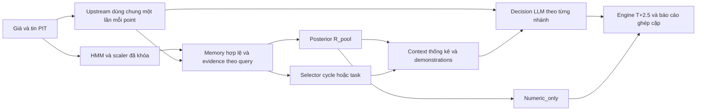

# Chương phương pháp: Regime-Aware Multi-Task Bayesian In-Context Learning

Bản thảo nội dung phương pháp để đưa vào khóa luận, ngày 22/10/2026.
Quy ước nghiên cứu theo [protocol v1 đã khóa](method_protocol_v1.md);
ánh xạ hiện thực và bằng chứng tại [README W10](README.md).
Các phép kiểm định và xác nhận chưa chạy được trình bày như thiết kế
đăng ký trước, không gán kết quả fixture thành hiệu quả kinh tế.
Đặc tả legacy tại [`docs/methodology_spec.md`](../../methodology_spec.md)
và kết quả W9 được giữ nguyên như lịch sử phiên bản trước.

## 1. Bài toán và đóng góp phương pháp

Nghiên cứu xét quyết định sau khi đóng cửa một phiên giao dịch cho bốn mã
FPT, MWG, VCB và VNM. Hệ thống đa agent tổng hợp chỉ báo, mẫu hình, xu
hướng và các báo cáo bổ trợ; Decision LLM nhận cùng thông tin đó để chọn
mua theo hợp đồng T+2.5 hoặc giữ tiền mặt. Câu hỏi nghiên cứu là liệu
thống kê posterior có điều kiện theo regime và các ví dụ lịch sử có cấu
trúc tác vụ có cải thiện quyết định so với hệ thống không prior và phương
pháp prior hiện hữu hay không.

[Zhu, Oermann và Cho (2026)](https://proceedings.mlr.press/v306/zhu26aj.html)
đề xuất huấn luyện transformer trên chuỗi prior/target tasks để học
predictive inference và thích ứng với họ prior. Đề tài này dùng LLM hosted
có sẵn: posterior được tính bằng mã ngoài LLM, còn thống kê và ví dụ được
đưa vào prompt. Đây là thích ứng miền theo hướng Bayesian ICL; thiết kế
không tái hiện quá trình huấn luyện của bài báo hoặc chứng minh LLM thực
hiện suy luận Bayes phân cấp bên trong.

Ba thành phần có vai trò riêng. Thành phần Bayesian ước lượng xác suất
sự kiện LONG ròng có lãi. Thành phần ICL cung cấp các cặp đặc trưng–nhãn
trước query mà không cập nhật trọng số mô hình. Thành phần multi-task nhóm
nhiều quan sát lịch sử thành những tác vụ có định danh và ranh giới rõ.
Decision LLM vẫn chọn hành động; posterior không tạo một lớp policy tự
động chặn LONG. Confidence tự khai của LLM không được coi là xác suất
posterior đã hiệu chuẩn.

## 2. Đơn vị quan sát, dữ liệu và phân chia thời gian

Một test point là cặp mã–ngày quyết định. Một historical cycle có ngày
quyết định, ngày vào, ngày ra, tín hiệu agent/regime và nhãn kinh tế sau
tất toán. Một task trong R_task chứa hai cycle khác nhau cùng mã, regime
và block thời gian. Các cycle có thể phụ thuộc nhau do regime và khoảng
nắm giữ; số record không được diễn giải thành số mẫu độc lập hữu hiệu.

| Khoảng dữ liệu | Vai trò trong revision |
| --- | --- |
| 2018–2022 | HMM/scaler và diagnostics train; bank gốc gồm 852 episode 2020–2022, giữ nguyên |
| 2023 | Development exploratory duy nhất, 60 point cố định: FPT=12, ba mã còn lại=16/mã |
| 2024 | Kết quả W9 đã xem; nguồn upstream lịch sử cho memory revision theo rule đã khóa; không là xác nhận mới |
| 2025 | Lịch ứng viên xác nhận 128 point/41 cutoff, 32/mã, tám/quý; chỉ chạy sau selection và release riêng |
| Forward sau lock | Phương án đăng ký riêng nếu exposure không còn đủ điều kiện; không đổi nhãn run 2026 đã có thành forward |

Revision tạo memory append-only từ bank 852 và tối đa 124 upstream đã lưu
(60 năm 2023, 64 năm 2024), union thành 976 episode sau kiểm tương thích,
dedup và provenance. Không gọi thêm LLM để tạo bank, không lấy action,
confidence hoặc justification Decision làm feature, không chọn record
theo lãi/lỗ. Việc dùng nguồn 2024 được công bố vì năm này đã ảnh hưởng
thiết kế; kết quả W9 vẫn được báo riêng cho phiên bản cũ.

Tại query ngày t, giá/tin chỉ đến t; tin không có ngày công bố bị loại.
Mọi prior phải có exit_date<t trước partition, centroid hoặc ranking.
Query 2023 không thấy cycle 2024, query không thấy chính cycle chưa đóng
của nó. Khi xác nhận 2025, không append cycle 2025 vào bank, kể cả đã đóng.
Model/scaler dùng đúng prefix train cho diagnostics và bản đóng băng đến
2022 cho development/xác nhận; không refit bằng dữ liệu sau train.

Giá nhãn sử dụng nguồn thực thi thô đã kiểm cùng quyền/lịch phiên, không
lấy chuỗi điều chỉnh hồi tố làm giá mua/bán. Audit 2025 đã kiểm giá/lịch
và exposure theo khai báo không dùng outcome để chọn/tune cùng inventory
local. Phạm vi đó không chứng nhận mọi outcome chưa từng được xem hoặc
thay thế yêu cầu khóa candidate/manifest/release trước xác nhận.

## 3. Hợp đồng kinh tế và biến mục tiêu

LONG mua tại Open(t+1), tất toán tại Close(t+3), với t+1/t+3 theo phiên
giao dịch. SHORT trong schema có nghĩa giữ toàn bộ tiền mặt. Gọi f=0,0025
là phí môi giới mỗi chiều và s=0,001 là trượt giá mỗi chiều. Return LONG
ròng dạng tỷ lệ là:

$$
r^{LONG}_t=
\frac{Close(t+3)}{Open(t+1)}
\frac{(1-s)(1-f)}{(1+s)(1+f)}-1.
$$

Nhãn $y_t=\mathbf{1}[r^{LONG}_t>0]$ được sinh bằng chính
`compute_round_trip_net_return` trong
[`core/backtest_engine.py`](../../../core/backtest_engine.py).
Return bằng 0 thuộc lớp không lãi; nhãn không lấy từ số đã làm tròn khi
hiển thị. SHORT có return giao dịch bằng 0; execution thiếu hoặc lỗi không
được đổi thành SHORT/CASH hợp lệ.

Mỗi nhánh có một tài khoản 50 triệu VND cho từng mã, dùng engine hiện hữu,
cổ phiếu lẻ và hệ số giá 1.000. Return được ghép theo đường vốn; không trừ
phí lần thứ hai hoặc thay bằng trung bình return các cycle. Với A và B là
hai nhánh, estimand kinh tế dùng điểm phần trăm:

$$
D_{A-B}=\frac{1}{4}\sum_{s\in\{FPT,MWG,VCB,VNM\}}
\left(R_{A,s}-R_{B,s}\right).
$$

Đây là trung bình đều bốn chênh lệch return tài khoản, không phải return
của portfolio tái cân bằng. MDD lấy từ equity path cùng engine và cùng
common support. Báo thêm hành động LONG/CASH, exposure và lỗi/thiếu; metric
phụ không thay estimand đã đăng ký.

## 4. Kiến trúc và posterior R_pool

Trong cùng mã, các cycle đã qua PIT được chia thành ba tập rời nhau:
C cùng regime và khớp Trend/Pattern query; B1 cùng regime nhưng không
thuộc C; B2 khác regime. Alpha/Indicator không là điều kiện của C.
Statistics không áp bộ lọc similarity/tuổi riêng của demonstrations và
không pooling chéo mã. Gọi $n_i$ là support, $s_i$ là số nhãn y=1 của tập i:

$$
m_2=\frac{s_2+1}{n_2+2},\qquad
m_1=\frac{s_1+\lambda m_2}{n_1+\lambda},
$$

$$
\theta_C\mid D\sim\operatorname{Beta}
\left(s_C+\lambda m_1,\ n_C-s_C+\lambda(1-m_1)\right).
$$

Posterior mean p và khoảng credible 95% lấy từ phân phối Beta. Khi n2=0,
m2=0,5 nhưng reason ghi thiếu background; không giả có support.
Đây là empirical Bayes plug-in: khoảng credible điều kiện trên hyperprior
ước lượng, chưa bao gồm toàn bộ bất định hyperprior và phụ thuộc giữa cycle.
Không dùng raw n thay cho effective sample size hoặc tự thu hẹp khoảng
để đạt quality gate.

Lambda chỉ xét {2,4,8}, chọn offline trên giao posterior hữu hạn của 651
query train và đối chứng A. Giữ missing riêng. Quy tắc chọn là mean log
loss nhỏ nhất, p clip [1e−6,1−1e−6], tie tolerance 1e−12, rồi Brier, rồi
lambda nhỏ hơn. Giao thực tế có 598 query, lambda đã khóa bằng **8**.
R_task dùng cùng posterior/lambda nên không nhận đóng góp calibration số
học độc lập. Diagnostics chọn lambda có selection bias; prediction dùng
đúng prefix nhưng lambda chọn cuối không được mô tả là lựa chọn online
đã biết ở các query 2021.

Stats ready khi nC≥5, n1+n2≥20 và độ rộng CrI≤0,75 trước làm tròn.
Examples ready là gate riêng, cần population cùng mã/regime nC+n1≥20,
feature/scaler AVAILABLE và có demonstration hợp lệ. Full trình từng
block ready; chỉ khi cả hai block off mới là prior-off. Posterior mean
không trở thành gate hành động của nhánh LLM.

## 5. Demonstrations R_pool và cấu trúc nhiều task R_task

R_pool giữ selector cycle legacy, tối đa K=3 cùng mã/regime. Bốn feature
momentum_5, momentum_20, volatility_20 và ma_distance_20 được chuẩn hóa
bằng scaler train của query. Ngưỡng similarity=0,625, w_signal=0,5,
half-life=365 ngày, tuổi tối đa 730 ngày từ as_of_date, min gap=5 phiên;
seed metadata=42. Giữ ranking/tie ID và loại entry–exit overlap; không
chọn ví dụ theo nhãn hoặc bù bằng cycle ngoài scope.

R_task chỉ thay demonstrations. Task được định danh bởi mã, regime và
block 20 phiên VNINDEX không chồng lấp, neo ngày **2018-01-02**:
$block\_id=\lfloor session\_index/20\rfloor$, index=0 tại ngày neo.
Chỉ cycle đủ PIT/tuổi/similarity/feature hữu hạn mới tham gia task.
Centroid là trung bình vector chuẩn hóa của các cycle đủ điều kiện,
không đọc nhãn query hoặc nhãn outcome để tính centroid/rank.

Task xếp theo khoảng cách RMS centroid–query tăng, ngày mới nhất giảm,
rồi ID tăng. Trong từng task, selector legacy cố định cặp hai cycle thỏa
gap/không overlap; task thiếu cặp bị loại. Khi chọn toàn demonstrations,
xung đột diversity/overlap làm bỏ cả cặp/task rồi xét task tiếp theo,
không thay thành viên để cứu cặp. Tối đa ba task, mỗi task đúng hai cycle.
Cycle đã nằm trong statistics không được cộng thêm lần nữa vào posterior.

Context nêu rõ legend x=T/P, y là nhãn LONG thắng/thua và return ròng %,
ranh giới task và các cặp x→y. Sidecar giữ ID/feature/nhãn/rank gốc;
return hiển thị hai chữ số nhưng nhãn lấy dấu số gốc. BRPP tối đa 600 ký
tự và toàn prompt Decision dưới 6.500 ký tự, giữ distill/cap. Nếu R_task
vượt budget, loại cả full/stats/examples của nó trên cohort trước API,
khóa lại ma trận và rotation; không cắt nhãn hoặc tăng budget để chạy.

## 6. Thí nghiệm ghép cặp, ablation và repeat

Upstream Indicator→Pattern→Trend và Full preparation chạy một lần mỗi
point; output được deep-copy cho các nhánh và repeat. Policy dùng cache
đã verify hoặc fresh shared khóa cho cả cohort trước Decision. A, R và
Numeric dùng chung bank/index/source snapshot tại query.

| Nhánh development | Nội dung và vai trò |
| --- | --- |
| Original | Context gốc, không prior; comparator chính |
| A_reference_shared_off | Evidence/prompt A_tp_pool trên memory revision và execution shared-off; đối chứng mạnh |
| R_pool_full / stats_only / examples_only | Ứng viên R_pool và hai ablation giữ cùng base evidence |
| R_task_full / stats_only / examples_only | Ứng viên R_task và hai ablation giữ cùng base evidence |
| Numeric_only | LONG nếu stats ready và p>0,5; còn lại CASH hợp lệ; không gọi LLM |

Chỉ hai full R là ứng viên. A dùng nguồn/execution revision nên không
được gọi là W9 chạy lại nguyên trạng. Numeric là heuristic xác suất,
không là policy tối ưu utility hoặc ứng viên ICL; p/gate thiếu hoặc
không hữu hạn là lỗi, không được dùng giá trị thay thế.

Decision giữ model/options/schema đã pin trong
[hướng dẫn vận hành](operations.md#2-cấu-hình-được-pin), risk OFF. Original
chạy đầu block và được lưu durable. Prior-off chỉ reuse Original cùng
point/repeat nếu toàn canonical request bằng nhau, gồm model/options/
messages/schema. Stats-only hai R chỉ alias khi cùng request và base
evidence. Alias lưu source/origin/hash, không tạo HTTP attempt giả.
Original_duplicate luôn có invocation độc lập.

Point sort theo ngày và thứ tự FPT/MWG/VCB/VNM, j từ 0. Primary xoay trái
các nhánh LLM còn lại theo j mod M, Original đầu, không tính Numeric.
Mẫu repeat có 12 point, ba/mã: earliest both-ready, one-block-ready và
off của R_pool; thiếu stratum bù earliest unused cùng mã và ghi reason.
Chọn bằng readiness/PIT trước action/return. Ba lượt bổ sung r=1,2,3 dùng
cùng request/upstream, thêm duplicate; xoay (3j+r−1) mod M, j theo mẫu
repeat đã sort, M gồm duplicate nhưng không Original/Numeric.
Tối đa 480 slot LLM primary, 324 slot repeat; HTTP thật đếm bằng ledger.

Repeat không nhập vào D primary, không vote hoặc chọn response thuận lợi.
Disagreement được báo cùng mẫu số, cả Original–duplicate và các contrast
theo từng lượt/mean. Prior-off disagreement bằng 0 do reuse là bất biến
execution, không chứng minh provider deterministic. Retry cùng UUID và
response cache giúp phục hồi; khi unknown không có response durable,
không cam kết exactly-once HTTP.

## 7. Selection, xác nhận và suy luận thống kê đã đăng ký

Development 2023 là exploratory đã xem, chỉ thực hiện một vòng với tối đa
hai ứng viên. Eligibility đòi đủ 60 point/common support, metric hữu hạn,
bốn gate đúng code/runtime, repeat đầy đủ đã verify, prior visible≥6 và
≥1/mã. R_task cần thêm ≥6 điểm có ≥2 task, ≥1/mã. Trên cache đã chuẩn bị,
chỉ ba điểm đạt điều kiện hai task và FPT=0; hiện chưa đủ coverage đề cử
R_task dù renderer/runtime đạt kỹ thuật.

Promotable khi D_R−Original>0, ΔR>0 tại ≥3/4 mã, mean ΔMDD≤2 và max
ΔMDD≤5 đpt, đồng thời D_R−A≥0. Trong tập promotable chọn D lớn nhất;
tie≤1e−9 đpt chọn mean ΔMDD nhỏ hơn, rồi R_pool. Không có promotable thì
STOP_NO_IMPROVEMENT; không mở xác nhận để cứu kết quả hoặc thêm ứng viên
thứ ba. Sửa hành vi sau xem outcome cần revision riêng, giữ run cũ.

Xác nhận mới dự kiến đúng 128 point/41 cutoff của audit 2025: lưới step3
neo phiên đầu năm, cycle đóng trong quý; lọc eligibility rồi chọn rank
floor(j*(N−1)/7), j=0..7, tám điểm/mã/quý. Không đủ N≥8 thì chặn, không
chọn ngày thay theo outcome. Chỉ một selected R, với Original, A,
selected full/stats/examples và Numeric; primary selected−Original,
secondary family đúng bốn contrast selected−A, full−stats, full−examples,
full−Numeric. Xác nhận còn cần source/protocol/power/selection/gate/
manifest/release trước API, chưa thực hiện ở W10. Giả thuyết chính là
$H_0:D_{selected-Original}\leq0$ và $H_1:D_{selected-Original}>0$;
bằng chứng xác nhận dùng CI hai phía 95% có cận dưới lớn hơn 0.

Protocol đăng ký circular moving-block bootstrap theo cụm cutoff date,
giữ mask mã và mọi nhánh cùng draw, dựng lại tài khoản theo thứ tự draw.
10.000 draw PCG64 seed=20261021, L=4; L=2/8 là sensitivity. Không sort lại
ngày gốc hoặc thay bằng mean cycle. Quantile linear, CI primary 95%,
secondary Bonferroni 98,75%; cần ≥9.500 draw hữu hạn không thiếu mã,
không sinh bù. G là toàn common support đã khóa; T both-ready chỉ mô tả.

Cận dưới CI primary>0 hỗ trợ cấu hình tốt hơn Original trên cohort;
secondary selected−A và các ablation đo những đóng góp tương ứng.
CI chạm/qua 0 là inconclusive, không chứng minh tương đương. Các CI điều
kiện trên Decision/phương pháp đã lưu, không bao gồm toàn bộ training/
provider variability. Repeat được báo riêng; trace tham chiếu task chỉ
là telemetry, không là bằng chứng cơ chế suy luận bên trong LLM.

Power audit từ proxy train/development đã khóa báo 30 scenario, không
dùng payoff 2025. Với main L4, CI95% width 4,93–29,15 đpt, MDE80
4,08–19,03 đpt tùy proxy. Đây là planning approximation có giới hạn donor,
location-shift và khác biệt Numeric/LLM; không chứng nhận revision đủ
power, không dùng để chọn lại N/prompt/lambda hoặc bỏ proxy bất lợi.

## 8. Tái lập, kiểm chứng và giới hạn

Plan, source, model/scaler/bank, runtime, schema, prefix/request, ma trận,
repeat và release có identity riêng. JSON Schema kiểm cấu trúc; semantic
verifier dựng lại evidence/request/report từ nguồn để chặn việc sửa
payload rồi tự băm lại. API qua wrapper retry và ledger chung, checkpoint
theo point/stage/branch, response durable trước khi kết thúc invocation.
Source, PIT, schema, cache hoặc marker sai phải dừng bằng lỗi integrity.

| Nội dung phương pháp | Hiện thực và bằng chứng kiểm tra |
| --- | --- |
| Kinh tế/PIT và nhãn | `core/backtest_engine.py`, `core/bic_icl_memory.py`; fixture tiền VND/fee/slippage và leakage |
| Partition/posterior và lambda | `core/bic_icl_statistics.py`, `core/bic_icl_diagnostics.py`; oracle/count/loss/fold |
| Task/demonstrations | `core/bic_icl_tasks.py`, `core/bic_icl_prompt.py`; centroid/rank/overlap, fixture VI/EN 3×2 |
| Canonical request/reuse/recovery | `core/bic_icl_decisions.py`; SDK mock, duplicate, shared-off/alias, crash/resume |
| Plan/cohort/report | `core/bic_icl_protocol.py`, `core/bic_icl_runtime.py`, `core/bic_icl_reports.py`; semantic/schema/nguồn và common support |
| Nghiệm thu kỹ thuật | [Source freeze, bốn gate và dry-run W10-07](README.md#w10-07--nghiệm-thu-toàn-revision-và-source-freeze-22102026) |
| Selection/bootstrap/xác nhận | [W11-05–07](../week11/README.md#checklist), triển khai/khóa theo protocol trước API tương ứng |

W10-07 có compileall, 1.083 unit, E2E và 235 leakage PASS. Dry-run thật
chỉ dựng context/metadata; HTTP mock và fixture tổng hợp chỉ kiểm hợp
đồng thực thi. Những bằng chứng này chưa chứng minh lợi thế kinh tế,
giá trị tăng thêm của demonstrations hoặc hiệu quả live.

Giới hạn còn gồm phạm vi bốn mã, giá/tin PIT hồi cứu và vintage sửa đổi,
kiến thức tiền huấn luyện LLM hosted, regime/sample thưa, phụ thuộc giữa
cycle, hyperprior plug-in và variability provider. Độ bao phủ task chưa
đủ phải được giữ trong eligibility và kết luận. W9 là bằng chứng riêng
của phiên bản cũ; revision thất bại hoặc chưa có xác nhận mới vẫn có thể
được báo trung thực trong khóa luận cùng các giới hạn đó.

## Tài liệu tham chiếu

Zhu, Q., Oermann, E. K., & Cho, K. (2026).
[Multi-Task Bayesian In-Context Learning](https://proceedings.mlr.press/v306/zhu26aj.html).
Proceedings of the 43rd International Conference on Machine Learning,
PMLR 306, 167564–167583. Tham chiếu dùng để định vị cách thích ứng;
các quy tắc tài chính và thí nghiệm của đề tài theo protocol local v1.
