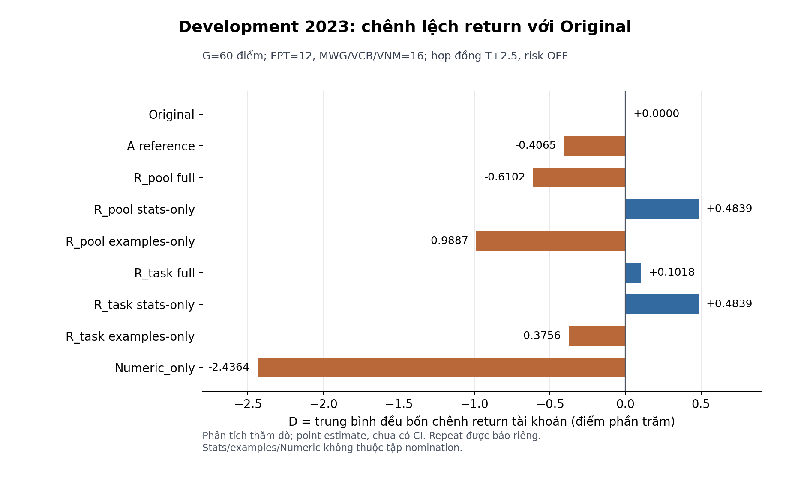

# Tuần 11 — Development, kiểm đóng góp ICL và khóa xác nhận

**Trạng thái: IN PROGRESS, 4/8; W11-04 DONE ngày 24/10/2026.**
[Kế hoạch tổng](../plan.md) · [W10](../week10/README.md) · [W12](../week12/README.md)

## Đầu vào và thời hạn

Chỉ bắt đầu API khi W10-07 PASS. Giữ HMM/model/options và risk OFF; bank
revision làm mới theo W10, cùng query snapshot cho A/R/Numeric;
người dùng tự chạy API bằng CLI sẽ được bàn giao, agent chuẩn bị/verify
offline. Không chạy lại W9 hoặc mở outcome xác nhận mới trong development.
Đầu W11 chạy/đối soát; giữa W11 repeat/analysis; cuối W11 khóa selection,
protocol, nguồn và release. Không kéo tối ưu sang W12.

## Đầu vào đã bàn giao từ W10

**W10 COMPLETE 8/8, Gate kỹ thuật W10 PASS.**
[Hướng dẫn API/resume/verify](../week10/operations.md) và
[bản thảo chương phương pháp](../week10/methodology_chapter.md) đã hoàn tất.
Khi bàn giao, W11 **0/8**. [W11-01](#w11-01--khóa-development-và-release-22102026)
đã hoàn tất. Primary thật đã chốt tại [W11-02](#w11-02--chốt-primary-development-23102026);
ba repeat đã chốt tại [W11-03](#w11-03--chốt-ba-repeat-development-24102026).
Xác nhận 2025 chưa mở.

| Đầu vào hiện có | Trạng thái dùng cho W11-01 |
| --- | --- |
| [Protocol v1](../week10/method_protocol_v1.md), schema/fixture riêng | Giữ ngữ nghĩa đã khóa; không đổi method bằng cập nhật README |
| Plan `bic_icl_v2/development_plan_v1.json` trong outputs | 60 point 2023, `VERIFIED_CACHE`, VI; SHA byte `c728af94811636cde5360c9b029602b1e1946af048db7ddfff3fd89802fac530` |
| Memory/index 976, lambda=8, context preflight | A/R/Numeric cùng nguồn; query chỉ thấy exit<cutoff; giữ scaler/model train-only |
| [Source freeze](../week10/validation_gates/revision_v1/source_freeze.json) và [receipt gate](../week10/validation_gates/revision_v1/technical_gates.json) | 85 dependency/runtime, 271 tệp gate; compileall/1.083 unit/E2E/235 leakage PASS tại W10-07, chưa chạy lại ở W10-08 |
| Dry-run 60 point, sample 12 point/ba repeat | Context digest `19db9111bdea7865478f809c188b5903d89b1090edb93fdb941d4c9e48250ddd`; metadata chưa là run/release đã đóng băng |
| Coverage R_task trên cache | Kỹ thuật available; chỉ 3 điểm có ≥2 task, FPT=0; chưa đủ eligibility đề cử, không nới ngưỡng |

W11-01 cần kiểm lại nguồn/gate, khóa policy upstream cho cả cohort và
đóng băng packet/request/context/repeat trước Decision. Với cache, kiểm
đủ 60 upstream và cấp release tham chiếu context lock. Nếu chọn fresh,
tạo plan/run mới, cấp release upstream-only, preflight/lock-upstream,
rồi verify và cấp release Decision có digest context lock. Consumer đã
có; **producer/verifier cache đã hoàn tất tại W11-01**. Phương án fresh chưa được phát hành.
Không dùng JSON tự khai hoặc receipt gate thay các bằng chứng này.

Plan/code/model/runtime/scaler/bank/schema/request/matrix/repeat và ledger
path phải bind đúng trước API. Giữ model/options/risk OFF; tokenizer cache
và preflight text/vision phải PASS cùng credential/plan trước run. Run thật
giữ `report_0.json` primary và `report_1/2/3.json` repeat riêng trong cùng
run root; xác minh complete/common support trước phân tích và selection.
Không lấy fixture HTTP mock hoặc report W9 làm Decision revision mới.

Chỉ clone Git không có đủ artifact ignored; giữ cùng workspace, archive
W9, model/scaler/index, nguồn giá/quyền/tin, ledger và response cache.
Các lệnh có điều kiện và xử lý Ctrl+C/quota/unknown nằm trong hướng dẫn;
mọi API thực nghiệm do người dùng chạy theo W11-02/03.

## Diagnostics train trước LLM

Tái dùng query train có proof PIT, tách fold theo thời gian như hệ thống cũ;
fit mọi hyperparameter/model/scaler chỉ bằng dữ liệu trước query. So A và
R_pool trên giao query có posterior hợp lệ, giữ missing riêng; báo log loss,
Brier, reliability bins cố định [0;0,2;0,4;0,6;0,8;1], counts từng mã/fold,
raw/ready coverage và mức co. Không gán p=0,5 cho prediction thiếu.
Khóa lambda từ {2,4,8} theo W10; R_task dùng cùng posterior nên không nhận
công cải thiện calibration số học độc lập. Loss tốt không đủ chứng minh ICL.

## Ma trận development và ablation

60 point ID năm 2023 giữ nguyên; mọi nhánh dùng một upstream/point và
deep-copy. Trước API khóa toàn ma trận; không reuse action W8/W9 như đối chứng
mới. Có thể reuse upstream cũ chỉ khi verifier chứng minh identity tương
thích; nếu không, tạo upstream mới một lần cho mọi nhánh. Lựa chọn này phải
khóa trước run, không chọn upstream tạo kết quả thuận lợi.

| Nhánh | Nội dung | Vai trò |
| --- | --- | --- |
| Original | Không prior | Primary comparator |
| A_reference_shared_off | Phương pháp/prompt A, memory chung và wrapper shared-off mới | Đối chứng mạnh trên cùng nguồn, không phải run W9 bất biến |
| R_pool full/stats/examples | Cùng base evidence, chỉ khác content mode | Ứng viên 1 và hai ablation |
| R_task full/stats/examples | Cùng base evidence, chỉ khác content mode | Ứng viên 2 và hai ablation |
| Numeric_only | LONG nếu posterior mean>0,5 và stats ready, còn lại CASH theo policy định trước | Đối chứng số học, không gọi LLM và không là ứng viên ICL |

Numeric_only là heuristic xác suất, không tối ưu utility và không được gọi
là policy Bayes tối ưu kinh tế. Evidence không đủ theo rule là CASH có
reason; lỗi/missing execution vẫn là incomplete, không điền CASH.
Nếu R_task bị BLOCKED trước API thì bỏ cả ba nhánh của nó và ghi reason.
Request stats-only của hai R nếu hoàn toàn giống thì alias một Decision;
giữ ID logic và source reference, không đếm alias là quan sát độc lập.
Tối đa tám nhánh LLM × 60 = 480 slot logic, cộng Numeric_only offline.
Số HTTP thật thấp hơn khi shared-off/alias; manifest khai cả logic/request.

Original chạy trước; xoay trái danh sách nhánh LLM còn lại theo index point
trong thứ tự (ngày, FPT/MWG/VCB/VNM), j mod M. Duplicate chỉ ở repeat.
Giữ schema/model/options giống nhau; không thêm seed LLM chưa được hỗ trợ.

## Repeat và kiểm tác động của context

Khóa mẫu 12 point trước Decision: mỗi mã ba điểm, mỗi stratum một điểm từ
both-ready, one-block-ready, off của R_pool. Chọn ngày sớm nhất trong mỗi
stratum; stratum rỗng bù ngày sớm nhất chưa chọn của cùng mã và ghi thiếu
support. Chỉ dùng readiness/metadata PIT, không action/return. Ba lượt bổ
sung/request, r=1/2/3, namespace riêng, upstream giữ chung primary.

Lặp mọi nhánh LLM đang có và Original_duplicate; Original trước, các nhánh
còn lại xoay (3j+r−1) mod M. Tối đa 12×9×3=324 slot; Numeric_only tính
một lần. Giữ raw responses/canonical body/timestamp/attempt, không coi HTTP
retry là lượt khoa học. Repeat không nhập vào D primary và không chọn lượt
tốt nhất. Báo action disagreement với mẫu số, full−Original/A/stats/examples
theo từng lượt và mean; không coi ba cặp lượt là độc lập.

Phân tích full−stats và full−examples trên G toàn bộ, và T cả hai block
ready cùng base. Trace tham chiếu task ID chỉ là telemetry; không suy nó
thành cơ chế nội tại. Có thể thêm fixture đổi nhãn giả để kiểm renderer/
sensitivity offline; không đưa nhãn giả vào primary hoặc bank thật và
không dùng phản ứng fixture để chứng minh hiệu quả giao dịch.

## Selection và điểm dừng

Tập nomination chỉ R_pool/R_task đủ kỹ thuật; A là chuẩn so, ablation và
Numeric_only không được chọn vì return đẹp. Eligibility: đủ 60 point/common
support, metric hữu hạn, bốn gate PASS, prior visible≥6 và ≥1/mã; đủ repeat
đã verify. Candidate dùng task format phải có ≥6 điểm gồm hai task trở lên,
phân bố ≥1/mã; thiếu thì không đủ evidence multi-task, không giả coverage.

Promotable development: D_R−Original>0; ΔR>0 ở ≥3/4 mã; mean ΔMDD≤2,
max ΔMDD≤5 đpt; thêm D_R−A≥0 để không chọn bản kém đối chứng mạnh trên
development. Đây là rule mới trước API, không sửa selection W8. Trong tập
promotable chọn D_R−Original lớn nhất; tie≤1e−9 đpt chọn mean ΔMDD nhỏ hơn,
rồi R_pool trước R_task. Repeat là chẩn đoán bắt buộc, không chọn lại bằng
lượt thắng. Báo bất ổn kể cả candidate được chọn.

Nếu không có promotable, dừng claim nâng cấp kinh tế; không mở xác nhận chỉ
để cứu kết quả, giữ A/W9 làm kết quả nghiên cứu và Original mặc định. Tối đa
một vòng development; sửa lỗi làm đổi action sau đã xem outcome phải revision
riêng, không lấy run mới tốt hơn thay run cũ. Có thể hết thời gian thì dừng
với exploratory. Không gộp R_pool/R_task thành ứng viên thứ ba.

## Protocol xác nhận mới phải khóa trước outcome

Chỉ mở khi exposure/giá/mẫu W10-01 PASS và có candidate eligible/promotable.
N=128, 32/mã, ngày theo W10; không thay điểm hoặc giảm N sau outcome.
Sáu nhánh logic: Original, A_reference_shared_off, selected_full,
selected_stats_only, selected_examples_only, Numeric_only. Năm nhánh LLM:
tối đa 640 slot primary; Numeric_only offline; shared-off/alias đúng protocol.
Không chạy cả R để chọn lại trên xác nhận. Một primary Decision/point/nhánh.

Đăng ký thêm 12 point chẩn đoán readiness theo cùng rule development,
ba lượt bổ sung, năm nhánh LLM + duplicate: 216 slot. Khóa sample/requests
trước action, dùng cùng upstream primary; không nhập repeat vào primary.
Nếu không đủ 12 point theo ngày hợp lệ thì BLOCKED, không chọn theo return.
Repeat đo provider variability; không tự tạo CI tổng hợp từ mẫu nhỏ này.

- Primary: D=(1/4)Σ(R_selected,s−R_Original,s), tài khoản 50 triệu/mã,
  lot/phí/giá engine, không là return portfolio hay mean cycle.
- Secondary family bốn contrast: selected−A, full−stats, full−examples,
  full−Numeric_only. Tất cả cùng G; T readiness là mô tả, không thay family.
- Circular moving-block bootstrap trên cụm ngày cutoff, giữ mã/nhánh cùng
  cụm, dựng lại tài khoản trong từng draw. L=4, 10.000 draws,
  PCG64 seed=20261021, percentile linear. Primary CI95%; secondary
  Bonferroni CI98,75%; sensitivity L=2/8 không thay CI chính. ≥9.500 draw
  hữu hạn, không sinh bù. Thời gian/lô/quyền của cycle dùng nguồn đã khóa.
- Báo count từng mã/draw, invalid reasons, common support và overlap cycle;
  thiếu nhánh/unknown → INCOMPLETE, không bỏ điểm lỗi hoặc điền CASH.
- CIs điều kiện trên Decision đã lưu, không bao gồm hoàn toàn training/
  provider variability; repeat được báo riêng. Không dùng CI này để tuyên
  bố LLM deterministic hoặc prior là nguyên nhân duy nhất.
- D CI>0: hỗ trợ cấu hình tốt hơn Original trên cohort. Selected−A CI>0:
  mới hỗ trợ vượt bản hiện hữu. Full−stats CI>0: hỗ trợ giá trị tăng thêm
  của demonstrations trong protocol; full−examples CI>0: hỗ trợ phần stats.
  Cả hai không tự chứng minh suy luận Bayes bên trong LLM. CI qua/chạm 0:
  inconclusive, không kết luận tương đương hay không có tác dụng.

W11-07 bind protocol/matrix/sample/order/selection, source/model/runtime,
prefix/schema/scaler/bank và receipt gate. Chưa producer/verifier/fixture
bootstrap tương ứng thì không phát hành release. Không sửa W9/manifest cũ.

## Checklist

| Task | Công việc | Phụ thuộc | Điều kiện hoàn thành | Trạng thái |
| --- | --- | --- | --- | --- |
| W11-01 | Kiểm nguồn/gate, khóa development và repeat plan | W10 | Dry-run/identity/nguồn PASS; release cache bind đủ snapshot/request/repeat/run/ledger | [x] DONE |
| W11-02 | Người dùng chạy primary development | 01 | Primary COMPLETE, 60/60 common support, 480 slot LLM complete; report/source/raw/ledger PASS | [x] DONE |
| W11-03 | Verify primary, chạy/verify ba repeat | 02 | Ba CLI verify-report PASS; 12/12 common support mỗi lượt, primary nguyên byte | [x] DONE |
| W11-04 | Phân tích economics/coverage/loss/T/G/repeat/failure | 03 | Bảng G/T/loss/coverage/repeat/failure, nhóm bất lợi/rỗng và oracle PASS | [x] DONE |
| W11-05 | Khóa selection hoặc STOP_NO_IMPROVEMENT | 04 | Rule và oracle độc lập khớp; không chọn ablation | [ ] TODO |
| W11-06 | Kiểm nguồn mới, công cụ report/bootstrap và bốn gate | 05 | Fixture oracle/PIT/canonical/reuse PASS đúng revision | [ ] TODO |
| W11-07 | Khóa manifest/release xác nhận hoặc BLOCKED | 06 | 128 điểm/sáu nhánh, repeat/protocol/exposure/hash trước outcome | [ ] TODO |
| W11-08 | Bàn giao run/resume/verify, khung chương và bảng | 07 | CLI thật; chốt không tối ưu tiếp W12; nhánh dừng có nội dung luận văn | [ ] TODO |

Nếu thiếu tập mới sạch hoặc không đạt selection, W11-06/07 ghi BLOCKED/
NOT_APPLICABLE đúng lý do, không đánh PASS giả. W12 vẫn hoàn thành luận văn
từ W9 và các kết quả exploratory mới, không kéo dài quá 12 tuần.

## W11-01 — Khóa development và release, 22/10/2026

**DONE; W11 1/8.** Chọn `VERIFIED_CACHE` cho toàn bộ 60 điểm development
2023 trước Decision; kiểm nguồn/gate W10 và dựng lại đủ upstream Full,
evidence A/R/Numeric, context, ma trận và mẫu repeat. Giữ HMM, model/options,
VI, risk OFF, memory/index 976, scaler train-only và lambda=8. Oracle so
trực tiếp population A và artifact W10-05: **60 evidence/prefix/prompt,
480 contract SDK, 117 prior-off và mẫu repeat 12 điểm PASS**, không fallback.
BRPP/prompt tối đa **518/4.671** ký tự, dưới trần 600/<6.500.

Producer/verifier mới
[`bic_icl_release.py`](../../../core/bic_icl_release.py) và
[`prepare_bic_icl_release.py`](../../../scripts/prepare_bic_icl_release.py)
hoàn toàn offline. Consumer kiểm snapshot thật và dựng lại semantic trước
đọc key; runtime còn kiểm đúng run root/ledger trước upstream/Decision.
Release chỉ được ghi sau bốn gate PASS, nguồn/code/runtime hiện tại khớp,
chưa có Decision/report/cache hoặc intent/HTTP cùng signature trong ledger.
Release đã có chỉ verify; file mất/sửa không được tạo lại để replay.
Tự sửa JSON/hash, schema SDK, thứ tự, nguồn PIT hoặc ledger path đều bị chặn.

| Artifact dùng từ W11-02 | Đường dẫn từ root |
| --- | --- |
| Plan theo mã đã tích hợp | `outputs/bayesian_benchmark/bic_icl_v2/development_plan_release_v2.json` |
| Run đã khóa offline | `outputs/bayesian_benchmark/bic_icl_v2/development_run_release_v2` |
| Release đã phát hành | [development_release_v1.json](development_release_v1.json) |
| Receipt bốn gate mới | [technical_gates.json](validation_gates/development_v1/technical_gates.json) |
| Bằng chứng/source/log/QA | [development_release_v1.zip](validation_gates/development_release_v1.zip) |

So với plan bàn giao W10, **chỉ trường `code_sha256` đổi**, bind **87
dependency** gồm producer/verifier mới; protocol/input/runtime/nguồn giữ
nguyên. Không ghi đè plan W10. SHA-256 byte plan mới
`d4b4a981e28e4d66934332bcd828d892db85845b8dcb31c9595570a84b1bf9f1`.
Run có `cohort.json`, **60 packet**, `context_lock.json` và
`request_manifest.json`: **63 artifact bất biến** được release kiểm byte.
Context digest
`39eb78b8da591fc4f6ef8cdc48e45869f89433e21c71471d720a85c48b25cf63`;
request manifest digest
`c8919cebb7311cc996e18ec5ead45c9270a0fefe06fa2b5c175327aa5c45ddbb`.
Ledger path tuyệt đối được bind, nội dung ledger tiếp tục tăng khi người
dùng chạy; producer không sửa ledger hoặc cấp ngân sách mới.

Khóa **96 block / 804 slot logic**: primary 480, ba repeat mỗi lượt 108.
Oracle độc lập kiểm rotation, canonical body/schema/model/options và alias
của toàn bộ slot PASS. Có **503 invocation độc lập dự kiến**: primary 317,
mỗi repeat 62 gồm 12 Original duplicate. Đây chưa là số HTTP thực;
retry/repair/recovery vẫn được đếm bằng ledger. Numeric chỉ ở primary,
repeat không nhập D. R_task vẫn available kỹ thuật nhưng chỉ **3 điểm có
≥2 task, FPT=0**, `task_coverage_eligible=false`; không nới ngưỡng đề cử.

**Nghiệm thu mã cuối trên Python 3.13.5:** compileall toàn codebase,
**1.103 unit / 139 module**, E2E xác định và
**249 leakage / 39 module PASS**; không lỗi,
skip hoặc expected failure. Hai suite dùng bốn process, chia nguyên module;
multiset ID khớp discovery, giữ bội số. Hash UTF-8/LF của **276 tệp** giữ
nguyên suốt lượt gate cuối. **20 test mới** kiểm release/CLI, alias/duplicate,
source/request sửa rồi tự băm lại, sai run/ledger, mất checkpoint và intent
unknown còn trong ledger; fixture SDK chỉ dùng HTTP mock ngoài workspace.

**Chín lệnh CLI thật PASS theo exit code dự kiến**: hai help, prepare,
dry-run, fixture kinh tế, verify release, reissue và hai guard thiếu
release/sai run root. Hai guard exit 1 trước credential/HTTP; bảy lệnh còn
lại exit 0. Plan/release/63 snapshot giữ nguyên byte và timestamp sau
verify/reissue; ledger giữ nguyên byte. Chưa tạo `primary_ready.json`,
Decision block hoặc `report_0/1/2/3.json` thật. Không đọc key, không API/LLM
thực nghiệm, không payoff/action 2025; `confirmation_allowed=false`.

ZIP **567 entry / 6.686.880 byte**, SHA-256 byte
`5e8d82637a831d3802a149068dec8d2d31c8b7d02a98b2909961328ed6e8a0c4`; manifest/hash từng entry và CRC PASS.
**6.670 tệp cũ nguyên byte**, gồm W9,
nguồn giá/tin/quyền, memory/train, ledger, plan/protocol và toàn bộ bằng chứng
W10; root README giữ nguyên. Diff/liên kết/hash PASS. ZIP giữ source theo
đúng byte đã chạy gate, plan và snapshot initial trước API để đối soát.

### Lệnh dùng cho W11-02

Chạy từ root bằng PowerShell, dùng đúng plan/run/release/gate dưới đây;
các lệnh mặc định và đường dẫn gate W10 trong hướng dẫn bàn giao cũ không
thay thế revision mới. Run đã có manifest/snapshot nên **lần Decision đầu
cũng dùng `--resume`**. Verify release offline dùng được ngay:

```powershell
$planPath = 'outputs/bayesian_benchmark/bic_icl_v2/development_plan_release_v2.json'
$runPath = 'outputs/bayesian_benchmark/bic_icl_v2/development_run_release_v2'
$gatePath = 'docs/plan/week11/validation_gates/development_v1/technical_gates.json'
$releasePath = 'docs/plan/week11/development_release_v1.json'

py -3.13 -X utf8 scripts/prepare_bic_icl_release.py --verify-only --plan $planPath --output-dir $runPath --release $releasePath --technical-gates $gatePath
```

**Hai lệnh API sau do người dùng chạy ở W11-02, chưa thực hiện trong task này.**
Cache tokenizer đã kiểm checksum offline; preflight text/vision phải PASS cùng credential và
plan trước run. Giữ model/options và ledger chung; nếu provider không phục
vụ model hoặc hết quota thì giữ checkpoint và xử lý theo
[hướng dẫn phục hồi](../week10/operations.md#7-dừng-phục-hồi-và-xử-lý-lỗi).

```powershell
py -3.13 -X utf8 scripts/run_bic_icl.py --preflight --plan $planPath --output-dir $runPath --handoff $releasePath --technical-gates $gatePath
py -3.13 -X utf8 scripts/run_bic_icl.py --run --resume --plan $planPath --output-dir $runPath --handoff $releasePath --technical-gates $gatePath
```

Sau primary, kiểm `status=COMPLETE`, đủ 60 point/common support và không
unknown; W11-03 còn verify primary và ba repeat riêng:

```powershell
py -3.13 -X utf8 scripts/run_bic_icl.py --verify-only --plan $planPath --output-dir $runPath
py -3.13 -X utf8 scripts/run_bic_icl.py --verify-report --plan $planPath --output-dir $runPath
```

Producer release hiện chỉ mở policy cache đã chọn. Không dùng các lệnh
fresh có điều kiện trong W10 để đổi cohort; fresh cần plan/run/release và
verifier tương ứng trước API. Plan và snapshot là ignored: giữ cùng
workspace và nguồn W9/W10 đã khóa, không chỉ clone Git rồi chạy.
**Tiếp theo W11-02; chưa selection hoặc mở xác nhận 2025.**

## W11-02 — Chốt primary development, 23/10/2026

**DONE; W11 2/8.** Người dùng đã chạy primary thật bằng plan
`development_plan_release_v2.json`, run `development_run_release_v2` theo
release cache W11-01. Preflight text/vision PASS cùng plan. Agent chỉ
kiểm offline bằng **CLI `--verify-report` hiện hữu**, exit 0,
`status=COMPLETE`, repeat_id=0; transport từ chối mạng, không đọc API key
hoặc gọi thêm API. Verifier dựng lại toàn report từ nguồn PIT, packet,
canonical request/schema/model/options, raw response, cache và ledger;
đồng thời tái tính economics theo engine đã khóa để so toàn payload.

| Điều kiện chốt primary | Kết quả |
| --- | --- |
| Lịch và common support | **60/60**, FPT 12, MWG/VCB/VNM 16 mỗi mã; không loại điểm |
| Ma trận | Tám nhánh LLM + Numeric_only, giữ shared upstream/point |
| Slot LLM | **480 complete**, 0 planned/unknown/error còn treo |
| Invocation khoa học | **317 UUID**, mỗi UUID đúng một attempt khoa học và một HTTP thành công |
| Reuse | **117 shared_original + 46 stats_alias**, không tạo HTTP giả |
| Numeric_only | **60 slot offline**, không gọi LLM |
| Attempt HTTP/transport trong ledger | **328**: 317 HTTP 200, 2 HTTP 429, 9 transport_error |
| Phục hồi | 11 attempt lỗi đã phục hồi cùng UUID; không còn unknown hoặc thiếu response durable |
| Audit resume | 2 dấu resume ở cấp nhánh, giữ UUID và không tính thành repeat |
| Binding report | **243 checkpoint + 328 HTTP record** khớp hash; đủ 317 response cache thành công |

Các lỗi HTTP lịch sử được giữ nguyên, không diễn giải thành lỗi execution
còn treo hoặc xóa retry để làm sạch kết quả. Pacing/model/prompt/options và
economic contract không đổi giữa run. Giữ risk OFF, lambda=8, cùng memory/
index/scaler train-only. Release, plan, context và request manifest vẫn
đúng byte đã khóa tại W11-01. R_task vẫn thiếu coverage đề cử: chỉ ba điểm
có ≥2 task và FPT=0; không nới ngưỡng vì đã chạy xong.

Report thật: `outputs/bayesian_benchmark/bic_icl_v2/development_run_release_v2/report_0.json`,
SHA-256 byte
`00771c113b0d4cc3ffbf370af789da3cee773e477d7aff2105c8c3cb95f9d4b2`.
Đã đóng băng nguyên byte report, checkpoint/packet/context/request,
317 raw response cache và snapshot ledger chung, cùng plan/release/gate,
log verifier và công cụ QA trong
[`development_primary_v1.zip`](validation_gates/development_primary_v1.zip):
**576 entry / 6.350.458 byte**,
SHA-256 byte
`162ee52e7ec80ecb8d51bd4c898a551052568938737b40b73207f8cec105bc6d`.
Manifest/hash từng entry và CRC PASS; **7.251 tệp cũ nguyên byte**
sau kiểm, gồm toàn bộ primary/ledger, nguồn và bằng chứng W9/W10/W11-01.
Chỉ metadata khóa OS có thể cập nhật. Root README giữ nguyên.

**Phạm vi kiểm:** chỉ cập nhật hai Markdown và thêm gói bằng chứng kết quả
đã có; không sửa code/test/runtime/schema/input, không tune pacing hoặc
chọn response khác. Theo **AGENTS.md 1.2**, **không chạy lại compileall,
unit, E2E hoặc leakage suite**. Đã đọc lại source/runtime và receipt gate
W11-01 PASS (1.103 unit/249 leakage, compileall/E2E); đây là gate cũ được
viện dẫn, không ghi thành lượt suite mới. Diff/link/hash PASS.

**Tại lúc chốt W11-02, chưa có `report_1/2/3.json`; W11-03 còn TODO.**
Nghiệm thu semantic
primary ở đây là điều kiện chốt W11-02, chưa thay ba repeat bắt buộc.
W11-04 còn phân tích economics/coverage/ablation/failure; chưa nomination,
bootstrap hoặc mở xác nhận 2025, `confirmation_allowed=false`.
**Bàn giao tại W11-02: người dùng chạy ba repeat riêng theo mẫu đã khóa.**

## W11-03 — Bàn giao ba repeat, 23/10/2026

**Tại thời điểm bàn giao 23/10: đã chuẩn bị offline, chưa DONE, W11 2/8.**
Primary đã được verify tại W11-02. Trước bàn giao repeat, đối soát lại
**564 artifact primary/plan/
release** với gói đóng băng: không đổi byte, gồm `report_0.json` với SHA
`00771c113b0d4cc3ffbf370af789da3cee773e477d7aff2105c8c3cb95f9d4b2`.
328 HTTP record primary vẫn khớp binding report. Source/runtime, 1.773
hash nguồn, 276 tệp source gate và receipt W11-01 khớp; preflight trong
ledger PASS cùng plan. Đây là đối soát hash/binding của lượt primary đã
verify, không ghi là chạy lại CLI semantic hoặc các suite.

Khi bàn giao, cả ba repeat chưa khởi tạo. Manifest đã khóa **12 điểm/mỗi
lượt, không fallback; 108 slot logic và 62 invocation độc lập/mỗi lượt**, gồm 12
Original duplicate độc lập. Đã đối soát đủ 324 slot: sample, rotation
`(3j+r−1) mod M` và canonical contract đều khớp primary; Numeric_only
không có trong repeat. Giữ upstream, ma trận, request, model/options và
risk OFF. Không thêm sample, thay response hoặc đổi pacing giữa run.

Người dùng chạy đoạn PowerShell sau từ root repository. Vòng lặp chạy
tuần tự r=1,2,3 và dừng nếu một lệnh lỗi. Nếu bị ngắt, giữ mọi artifact,
chạy lại đoạn này; `--resume` dùng lại lượt đã complete và tiếp tục phần
còn thiếu theo UUID, không mở một lượt khoa học mới.

```powershell
$planPath = 'outputs/bayesian_benchmark/bic_icl_v2/development_plan_release_v2.json'
$runPath = 'outputs/bayesian_benchmark/bic_icl_v2/development_run_release_v2'
$gatePath = 'docs/plan/week11/validation_gates/development_v1/technical_gates.json'
$releasePath = 'docs/plan/week11/development_release_v1.json'

foreach ($repeatId in 1, 2, 3) {
    py -3.13 -X utf8 scripts/run_bic_icl.py --run --resume --repeat-id $repeatId --plan $planPath --output-dir $runPath --handoff $releasePath --technical-gates $gatePath
    if ($LASTEXITCODE -ne 0) { throw "Repeat $repeatId lỗi; giữ checkpoint và xử lý trước khi tiếp tục." }
}
```

Nếu đổi credential, người dùng chạy lại preflight theo W11-02 với đúng
plan/run/release/gate trước repeat; CLI vẫn kiểm fingerprint credential.
Mỗi lượt kết thúc cần `status=COMPLETE`, tạo riêng `report_1.json`,
`report_2.json`, `report_3.json` trong cùng run root.

Khi đủ ba report, agent dùng CLI `--verify-report --repeat-id 1/2/3`
offline để dựng lại từng report; kiểm đủ 12 point/common support, schema/
request/source/ledger/raw/cache, duplicate độc lập, Numeric chỉ primary
và primary nguyên byte trước khi chốt W11-03. Không nhập repeat vào D
primary, chọn lượt tốt nhất, phân tích hoặc selection ở bước chuẩn bị này.

Chỉ cập nhật hai Markdown; không đổi code/test/runtime/schema/input hoặc
tạo request/API. Theo AGENTS.md 1.2, không chạy lại compileall/unit/E2E/
leakage; viện dẫn đúng gate W11-01 trên source/runtime không đổi. Khi bàn
giao chưa có report repeat thật nên chưa đánh PASS phần thực nghiệm hoặc
tăng checklist lên 3/8. Giữ `confirmation_allowed=false`.

## W11-03 — Chốt ba repeat development, 24/10/2026

**DONE; W11 3/8.** Người dùng đã chạy đủ ba repeat trên plan/run/release
đã khóa. Agent chạy mới **ba CLI `--verify-report --repeat-id 1/2/3`
offline, exit 0**, dựng lại toàn report từ source/PIT/packet/request,
checkpoint, raw response, ledger và economics hiện hữu. Transport từ chối
mạng, `--env-file` trỏ tệp không tồn tại; agent không đọc key hoặc gọi API.

| Repeat | Common support | Slot logic complete | Invocation độc lập | HTTP 200 / 429 | Dấu resume nhánh |
| --- | --- | --- | --- | --- | --- |
| 1 | 12/12, mỗi mã 3 | 108 | 62 | 62 / 1 | 1 |
| 2 | 12/12, mỗi mã 3 | 108 | 62 | 62 / 0 | 0 |
| 3 | 12/12, mỗi mã 3 | 108 | 62 | 62 / 1 | 1 |

Đủ **324 slot logic complete, 186 UUID khoa học**, mỗi UUID đúng một
attempt khoa học và một response HTTP 200 durable. Mỗi lượt có 50 invocation
LLM thường, **12 Original duplicate độc lập**, 39 shared_original và 7
stats_alias; tổng 36 duplicate, không alias sang Original. Đúng 12 point ID
đã khóa, không fallback/exclusion; rotation `(3j+r−1) mod M`, canonical
request/model/options và shared upstream khớp primary. Numeric_only chỉ
thuộc primary. Không nhập repeat vào kết quả primary hoặc chọn response.

HTTP của riêng repeat là **188 attempt: 186 HTTP 200 và 2 HTTP 429**;
hai lần quota ở repeat 1/3 đã phục hồi cùng UUID. Giữ cả dấu resume và
lịch sử lỗi; không còn checkpoint/HTTP unknown chưa giải quyết. Preflight
text/vision cuối PASS cùng plan/credential ghi trong ledger. Toàn run
primary + repeat có **516 attempt: 503 HTTP 200, 4 HTTP 429, 9 transport_error**;
đủ 503 response cache thành công, không đếm trùng primary trong ba binding.
Mỗi report repeat bind 280 checkpoint; số HTTP record gồm primary lần lượt
391/390/391. Schema/request/source/raw/cache/ledger và common support PASS.

**564 artifact primary/plan/release nguyên byte** so với gói W11-02,
gồm `report_0.json` SHA
`00771c113b0d4cc3ffbf370af789da3cee773e477d7aff2105c8c3cb95f9d4b2`.
Giữ nguyên 3.370 HTTP record đã có trong snapshot ledger W11-02;
chỉ nối lịch sử mới. Plan/release/context/request, 1.773 hash nguồn,
87 tệp mã phụ thuộc, runtime và 276 tệp source gate khớp. Risk OFF, model/HMM/
scaler/memory/lambda/pacing và hợp đồng T+2.5 giữ nguyên.

| Report đã verify | SHA-256 byte |
| --- | --- |
| `report_1.json` | `e6815412d1ad7e91cfd56e6862148fecb79fb539c783d23828c0c442d97ea8c1` |
| `report_2.json` | `09f90d63afaa861ee44c9aacafed95987bdd91956e0c4d3dc7a07ba145f9767f` |
| `report_3.json` | `7daffc3bb0ee4fb4c0e2be8b321678f6ed1e846768e6821c0acfd35b85198183` |

Đóng băng nguyên byte primary/ba report repeat, checkpoint/packet/context/
request, toàn response cache và snapshot ledger, plan/release/gate/log cũ,
ba log verifier và công cụ QA trong
[`development_repeats_v1.zip`](validation_gates/development_repeats_v1.zip):
**880 entry / 7.667.860 byte**, SHA-256 byte
`d124b09c85ee86d5656101b0118eeaed6dba553c84313668678d7f27371d0c30`.
Manifest/hash từng entry và CRC PASS; **7.551 tệp cũ nguyên byte** qua
verifier/đóng gói, trừ metadata khóa OS không thuộc bằng chứng khoa học.

**Phạm vi kiểm:** hai Markdown và gói bằng chứng kết quả đã có; không đổi
code/test/runtime/schema/input. Theo AGENTS.md 1.2,
**không chạy lại compileall/unit/E2E/leakage**; đọc lại receipt W11-01
PASS (1.103 unit/249 leakage, compileall/E2E) trên source/runtime không đổi,
không ghi thành lượt suite mới. Ba CLI verifier trên là kiểm nghiệm thu mới.
Diff/liên kết/hash PASS, root README nguyên byte.

**Tiếp theo W11-04:** phân tích economics/coverage/loss/T/G/repeat/failure.
W11-03 chưa chọn R, nomination, bootstrap hoặc mở xác nhận 2025;
giữ ngưỡng R_task (chỉ 3 điểm ≥2 task, FPT=0) và
`confirmation_allowed=false`.

## W11-04 — Phân tích development, 24/10/2026

**DONE; W11 4/8.** Phân tích mô tả từ primary 60 điểm và ba repeat đã
verify W11-03, không đổi Decision hay chọn response. Đối soát nguyên byte
**871 artifact** trong ZIP W11-03, 1.773 hash nguồn, 87 tệp mã phụ thuộc và
runtime, 276 tệp source gate và diagnostics train đã khóa. G=60 complete:
FPT 12, MWG/VCB/VNM 16; không missing execution/exclusion, không thêm 2025.

### Economics và hành động trên G

LONG Open(t+1)→Close(t+3), phí/slippage hai chiều, SHORT=CASH; bốn tài khoản
50 triệu, cổ phiếu lẻ và risk OFF như engine. D là trung bình đều bốn chênh
return tài khoản, không là mean cycle hoặc return portfolio tái cân bằng.
Đã dựng lại bằng engine và oracle độc lập ghép growth factor từ giá mua/bán
sau phí; return, MDD, cycle payoff và toàn metric primary khớp report cũ.

| Nhánh | R FPT % | R MWG % | R VCB % | R VNM % | D so Original, đpt |
| --- | --- | --- | --- | --- | --- |
| original | 1,3082 | 11,3502 | 2,4399 | 1,9378 | 0,0000 |
| A_reference_shared_off | 3,6370 | 11,3502 | -1,5148 | 1,9378 | -0,4065 |
| R_pool_full | 3,2976 | 10,8747 | -1,5148 | 1,9378 | -0,6102 |
| R_pool_stats_only | 1,3082 | 13,2856 | 2,4399 | 1,9378 | 0,4839 |
| R_pool_examples_only | 1,3082 | 11,3502 | -1,5148 | 1,9378 | -0,9887 |
| R_task_full | 1,3082 | 11,7572 | 2,4399 | 1,9378 | 0,1018 |
| R_task_stats_only | 1,3082 | 13,2856 | 2,4399 | 1,9378 | 0,4839 |
| R_task_examples_only | 1,3082 | 9,8479 | 2,4399 | 1,9378 | -0,3756 |
| Numeric_only | 0,0000 | 7,2904 | 0,0000 | 0,0000 | -2,4364 |



MDD đo trên equity cuối chu kỳ; ΔMDD dương là drawdown tăng so Original.
MDD Original theo mã lần lượt
5,1235/2,6936/4,0222/1,3190%. Classification dưới đây gộp **60 point**,
24 nhãn UP/36 DOWN; Balanced là trung bình recall hai lớp trên mẫu đó.
Participation=LONG/60, cash rate=1−participation; hit lấy mẫu số LONG.

| Nhánh | LONG | Accuracy % | Balanced % | Hit LONG % | Mean ΔMDD đpt | Max ΔMDD đpt |
| --- | --- | --- | --- | --- | --- | --- |
| original | 18/60 | 63,33 | 59,72 | 55,56 | 0,0000 | 0,0000 |
| A_reference_shared_off | 17/60 | 61,67 | 57,64 | 52,94 | 0,0000 | 0,0000 |
| R_pool_full | 16/60 | 60,00 | 55,56 | 50,00 | -0,2273 | 1,3128 |
| R_pool_stats_only | 19/60 | 65,00 | 61,81 | 57,89 | 0,0000 | 0,0000 |
| R_pool_examples_only | 16/60 | 60,00 | 55,56 | 50,00 | 0,0000 | 0,0000 |
| R_task_full | 20/60 | 63,33 | 60,42 | 55,00 | 0,3282 | 1,3128 |
| R_task_stats_only | 19/60 | 65,00 | 61,81 | 57,89 | 0,0000 | 0,0000 |
| R_task_examples_only | 19/60 | 61,67 | 58,33 | 52,63 | 0,3282 | 1,3128 |
| Numeric_only | 4/60 | 60,00 | 51,39 | 50,00 | -2,7239 | -0,4308 |

R_pool full chỉ tăng return ở FPT, giảm ở MWG/VCB, VNM bằng Original;
R_task full chỉ tăng ở MWG, ba mã còn lại bằng Original. D so A lần lượt
**−0,2037/+0,5083 đpt**; full so Numeric **+1,8262/+2,5382 đpt**.
Stats-only có D cao hơn hai full trong lượt này; A/ablation/Numeric vẫn
không thuộc tập nomination. Kết quả là point estimate exploratory, chưa CI.
JSON trong ZIP giữ đủ return/MDD/equity, confusion, accuracy, participation,
hit và Sharpe/Sortino cycle từng mã/nhánh; không annualize hoặc giấu null.

### Coverage và support

Stats/examples ready và visible là các mẫu số khác nhau. A full có
stats/examples/both/visible/off = **45/41/36/50/10** trên 60 điểm; readiness
stats của A theo metric gate hiện hữu. Hai R dùng chung posterior:

| Base | Mã | G | Stats | Examples | Both=T | Visible | Off |
| --- | --- | --- | --- | --- | --- | --- | --- |
| R_pool | FPT | 12 | 8 | 5 | 4 | 9 | 3 |
| R_pool | MWG | 16 | 14 | 13 | 13 | 14 | 2 |
| R_pool | VCB | 16 | 10 | 12 | 9 | 13 | 3 |
| R_pool | VNM | 16 | 14 | 11 | 10 | 15 | 1 |
| R_task | FPT | 12 | 8 | 3 | 2 | 9 | 3 |
| R_task | MWG | 16 | 14 | 6 | 6 | 14 | 2 |
| R_task | VCB | 16 | 10 | 3 | 3 | 10 | 6 |
| R_task | VNM | 16 | 14 | 9 | 8 | 15 | 1 |

R_pool tổng stats/examples/both/visible/off = **46/41/36/51/9**;
R_task = **46/21/19/48/12**. Có **10/60 query feature UNAVAILABLE**
(FPT5/MWG1/VCB1/VNM3), không điền vector hoặc response thiếu.
Stats off do nC<5: 14/60; examples pool thiếu qualified 14, feature 10,
regime population<20 có 7; task thiếu cặp qualified 37, feature 10,
population 7. Reason có thể chồng nhau, không cộng thành số query off.
R_task raw k_tasks=0/1/2 là **37/20/3**; examples visible 21 điểm,
chỉ **3 điểm có ≥2 task, mỗi MWG/VCB/VNM một, FPT 0**. Không tăng support
bằng repeat cùng điểm, không nới ngưỡng bằng việc chạy đủ API.
Primary prior-off so Original: A **0/10**, R_pool full **0/9**, R_task full
**0/12** disagreement. Mọi view/round off được kiểm =0 theo reuse canonical;
đây là bất biến triển khai, không là bằng chứng LLM dùng prior hiệu quả.

### Posterior loss, reliability và mức co

λ=8 đã khóa bằng train W10-04; không chọn lại theo development/return.
Tất cả lambda train dùng cùng 598 posterior hữu hạn với A, không lọc
readiness; 53 query train thiếu A giữ missing. Development chấm cùng 58:
A thiếu `VNM-2023-03-30`, `FPT-2023-05-11`, R8 raw đủ 60 nhưng hai điểm
nC=0 không được gọi là conditional evidence đã quan sát. Clip loss
[1e−6;1−1e−6], không điền p=0,5 cho A thiếu.

| Tập | Posterior | Query | Common | Raw | Ready | Log loss | Brier |
| --- | --- | --- | --- | --- | --- | --- | --- |
| Train 2021–22 | A | 651 | 598 | 598 | 355 | 0,69645620 | 0,25078170 |
| Train 2021–22 | R2 | 651 | 598 | 651 | 399 | 0,70995949 | 0,25573325 |
| Train 2021–22 | R4 | 651 | 598 | 651 | 399 | 0,69371112 | 0,24954020 |
| Train 2021–22 | R8 | 651 | 598 | 651 | 399 | 0,68332577 | 0,24496989 |
| Dev 2023 | A | 60 | 58 | 58 | 45 | 0,70716163 | 0,25009158 |
| Dev 2023 | R8 | 60 | 58 | 60 | 46 | 0,68841586 | 0,24477866 |

Dev Δlog loss R8−A = **−0,01874577**, ΔBrier = **−0,00531292**.
FPT là subgroup bất lợi: 0,69516912 so A 0,69420418 (n=11);
MWG/VCB/VNM n=16/16/15 đều giảm log loss. Train giữ R2 bất lợi toàn bộ,
VCB/train2021 R8 0,63908462 > A 0,63354190 (n=78). Toàn ba lambda,
tám fold/mã, regime, bin và leave-one-quarter-out được giữ trong JSON.
Chọn λ trên toàn train có selection bias, không là lựa chọn online năm 2021
hoặc bằng chứng calibration/LLM không chệch. Hai R cùng posterior, không
nhận thêm công calibration cho task format. Reliability dev (n=58):

| Bin | A: n / p̄ / ȳ | R8: n / p̄ / ȳ |
| --- | --- | --- |
| [0,0;0,2) | 8 / 0,1709 / 0,6250 | 1 / 0,1906 / 1,0000 |
| [0,2;0,4) | 29 / 0,3105 / 0,2414 | 38 / 0,3088 / 0,3158 |
| [0,4;0,6) | 20 / 0,4838 / 0,5500 | 18 / 0,4773 / 0,5556 |
| [0,6;0,8) | 1 / 0,7143 / 0,0000 | 1 / 0,6211 / 0,0000 |
| [0,8;1,0] | 0 / NA / NA | 0 / NA / NA |

Bin rỗng giữ NA; số đếm nhỏ, không suy calibration tốt chỉ từ mean loss.
R8 train: mean hyperprior weight **0,575514**, mean |p−raw rate|
**0,129289 trên 598** có conditional history; 53/651 thiếu history.
Dev tương ứng **0,481023**, **0,085660 trên 58**; hai raw support=0 giữ
reason/off. Weight/count không là effective sample size; CrI có điều kiện
trên hyperprior plug-in. Loss tốt hơn A chưa thành ưu thế kinh tế full.

### Ablation trên G và T

T riêng cho từng R: stats **và** examples ready trên cùng base/query.
T_pool=36, T_task=19; G vẫn 60. Các tài khoản T được dựng lại chỉ trên T,
không lấy chênh của tài khoản G rồi lọc cycle, không thay G bằng T.
Các số sau là D đpt, trung bình đều bốn tài khoản trên support tương ứng:

| Base | T n (FPT/MWG/VCB/VNM) | Full−stats G | Full−stats T | Full−examples G | Full−examples T |
| --- | --- | --- | --- | --- | --- |
| R_pool | 4/13/9/10 | -1,0941 | -0,1397 | 0,3785 | 0,3575 |
| R_task | 2/6/3/8 | -0,3821 | -0,3732 | 0,4773 | 0,4662 |

Full−stats âm trên cả G/T cho hai R: các ước lượng điểm này chưa ủng hộ
lợi ích tăng thêm của demonstrations. Full−examples dương mô tả phần statistics
trong lượt đã lưu; chưa có CI, không chứng minh suy luận Bayes nội tại.
R_task T vẫn gồm nhiều điểm chỉ một task. Task-ID exact-string mention
trong R_task full là **0/21** điểm có task visible; đây chỉ là dò text thô,
không chứng minh dùng/không dùng context hoặc cơ chế multi-task.

### Repeat và nhóm bất lợi/rỗng

Mỗi nhánh trong chín nhánh repeat có action disagreement **0/36** cặp
(r1,r2)/(r1,r3)/(r2,r3), **không độc lập**. Tám nhánh LLM có trong primary
đều 0/12 khi so primary cùng mẫu với từng repeat. Original duplicate
0/12 mỗi lượt, tổng 0/36; UUID độc lập, không vote. Bốn contrast cho mỗi full:

| Contrast | Primary cùng 12 | r1 | r2 | r3 | Mean r1–3, đpt |
| --- | --- | --- | --- | --- | --- |
| R_pool_full − original | 0,5803 | 0,5803 | 0,5803 | 0,5803 | 0,5803 |
| R_pool_full − A_reference_shared_off | 0,5803 | 0,5803 | 0,5803 | 0,5803 | 0,5803 |
| R_pool_full − R_pool_stats_only | 0,5803 | 0,5803 | 0,5803 | 0,5803 | 0,5803 |
| R_pool_full − R_pool_examples_only | 0,5803 | 0,5803 | 0,5803 | 0,5803 | 0,5803 |
| R_task_full − original | 0,0000 | 0,0000 | 0,0000 | 0,0000 | 0,0000 |
| R_task_full − A_reference_shared_off | 0,0000 | 0,0000 | 0,0000 | 0,0000 | 0,0000 |
| R_task_full − R_task_stats_only | 0,0000 | 0,0000 | 0,0000 | 0,0000 | 0,0000 |
| R_task_full − R_task_examples_only | 0,0000 | 0,0000 | 0,0000 | 0,0000 | 0,0000 |

Mẫu 12 có D R_pool dương cả primary và repeat; không thay D primary 60
−0,6102 bằng +0,5803 của mẫu 12. Zero disagreement chỉ mô tả action trên
mẫu/hosted snapshot này, không chứng nhận LLM deterministic hoặc bỏ
provider/training variability. Không gộp repeat vào G hay chọn lượt thắng.

| Nhóm | n (FPT/MWG/VCB/VNM) | D R_pool−Original | D R_task−Original |
| --- | --- | --- | --- |
| BULL | 2/3/3/3 | 0,7870 | 0,0000 |
| BEAR | 0/0/0/0 | NA | NA |
| CHOPPY | 5/7/7/7 | -1,0890 | 0,4345 |
| CONSOLIDATION | 5/6/6/6 | -0,3791 | -0,3791 |
| Q1 | 0/4/4/4 | NA | NA |
| Q2 | 4/4/4/4 | 0,4840 | -0,3421 |
| Q3 | 4/4/4/4 | -0,2744 | 0,4748 |
| Q4 | 4/4/4/4 | -0,8139 | 0,0000 |

BEAR không có mẫu; Q1 thiếu FPT nên D bốn tài khoản=NA. Không điền 0,
đổi sang trung bình ba mã hay gọi nhóm rỗng là không có tác dụng.
Các nhóm khác được dựng tài khoản riêng; không cộng D subgroup thành D G.

### Failure và giới hạn đóng góp

| Nhánh | LONG lỗ | CASH bỏ lỡ LONG lãi | CASH tránh LONG lỗ |
| --- | --- | --- | --- |
| original | 8 | 14 | 28 |
| A_reference_shared_off | 8 | 15 | 28 |
| R_pool_full | 8 | 16 | 28 |
| R_pool_stats_only | 8 | 13 | 28 |
| R_pool_examples_only | 8 | 16 | 28 |
| R_task_full | 9 | 13 | 27 |
| R_task_stats_only | 8 | 13 | 28 |
| R_task_examples_only | 9 | 14 | 27 |
| Numeric_only | 2 | 22 | 34 |

R_pool full đổi action so Original **6/60**: hai ca có payoff cycle tốt hơn
(`FPT-2023-06-27`, `MWG-2023-06-30`), bốn ca xấu hơn
(`MWG-2023-04-28`, `VCB-2023-08-29`, `VCB-2023-10-30`, `FPT-2023-11-23`).
R_task full đổi **2/60**: tốt hơn `MWG-2023-08-29`, xấu hơn
`MWG-2023-04-28`. Đây là attribution cycle, không cộng để thay D tài khoản.
Trong 46 điểm R có stats visible, 42 có p<0,5; pool/task full vẫn LONG
**9/42 và 10/42**. LLM giữ quyền quyết định theo risk OFF; không gắn thêm
overlay hoặc gọi các LONG này là lỗi thực thi. JSON giữ toàn bộ 540 case,
cả adverse, lỗ, bỏ lỡ, tránh lỗ, IDs và hai chiều thay action.
Ledger vẫn 516 attempt: 503 HTTP 200, 4 HTTP 429, 9 transport_error đã phục
hồi; không còn execution unknown. Retry/quota là failure vận hành đã xử
lý, không là repeat khoa học hoặc missing được đổi CASH.
PIT xác minh thời điểm của input; không chứng nhận vintage kiến thức của
LLM hosted trên dữ liệu lịch sử. Giới hạn này áp cho cả đối chứng và hai R.

### Bằng chứng, tái lập và bước tiếp

[`development_analysis_v1.zip`](validation_gates/development_analysis_v1.zip)
có **9 entry / 598.133 byte**, SHA-256 byte
`3df42b45c1a0960da24f08a61b9bcc20494abbbbe517e307b44098f891ffff7d`.
Gồm `analysis.json` đầy đủ bảng/case/bins/fold/subgroup/repeat, mã phân tích,
oracle/QA, baseline và PNG/SVG. Manifest/hash/CRC và xem biểu đồ PASS.
Để tái lập trong cùng workspace: giải nén QA ngoài repo, từ root chạy
`py -3.13 -X utf8 <qa>/analyze.py` rồi `py -3.13 -X utf8 <qa>/chart.py`;
giữ các ZIP và nguồn ignored đã bind. Không cần credential/LLM,
không mở outcome 2025.
**7.552 tệp cũ nguyên byte**, gồm report0–3, ledger, W9/W10 và nguồn;
root README nguyên byte. Chỉ hai Markdown, biểu đồ và gói phân tích mới,
không đổi code/test/runtime/schema/input. Theo AGENTS.md 1.2,
**không chạy lại compileall/unit/E2E/leakage**. Đọc lại gate W11-01
PASS (1.103 unit/249 leakage, compileall/E2E) và source/runtime không đổi;
không ghi gate cũ hoặc verifier W11-03 thành lượt chạy mới của task này.
Oracle tài khoản/payoff/MDD, loss/confusion/support/bin/repeat, diff/link/hash
PASS. **Tiếp theo W11-05** mới khóa selection hoặc STOP_NO_IMPROVEMENT
theo rule đã đăng ký; W11-04 chưa nomination, bootstrap, phát hành release
hoặc chạy xác nhận; `confirmation_allowed=false`.
