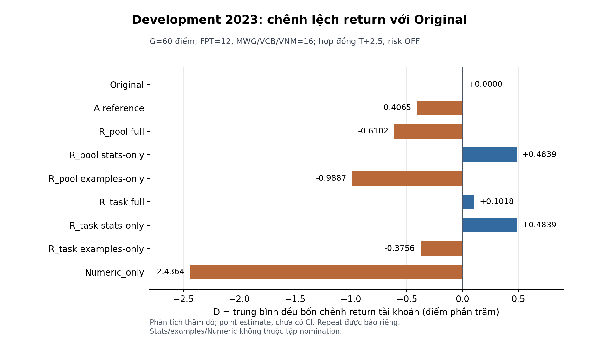

# Khung chương kết quả và thảo luận — Bayesian ICL

Bản thảo bàn giao ngày 24/10/2026 cho W12-04. Số liệu lấy từ bằng chứng đã
khóa; W12 hoàn thiện văn phong, đánh số chương/bảng/hình và định dạng bản
nộp. [Chương phương pháp](../week10/methodology_chapter.md) trình bày mô
hình, kinh tế, PIT và giao thức; [README W11](README.md) quản lý tiến độ.

## 1. Phạm vi bằng chứng và thước đo

| Thực nghiệm | Dữ liệu và support | Vai trò trong luận văn |
| --- | --- | --- |
| W9, cấu hình A_tp_pool đã chọn trước holdout | Năm 2024; G=64, 16/mã, 20 ngày cutoff | Kết quả kiểm định của phiên bản cũ; CI theo protocol đã khóa |
| W11, R_pool/R_task, λ=8 từ train | Development 2023; G=60, FPT/MWG/VCB/VNM=12/16/16/16 | Phát triển và quyết định dừng revision; số liệu mô tả, chưa có CI xác nhận |
| Repeat W11 | 12 điểm đã chọn trước Decision, 3/mã; ba lượt bổ sung | Chẩn đoán biến thiên action trên cùng mẫu; không tăng G hoặc thay primary |
| Xác nhận revision trên 2025 | Chưa chạy, không có candidate promotable/release | NOT_RUN; không có ước lượng hiệu quả hoặc CI mới |

Không gộp W9 và W11 thành một mẫu, không xem A_reference_shared_off chạy
trong W11 là kết quả A_tp_pool bất biến của W9. Năm dữ liệu khác với thời
điểm gọi mô hình hosted; đây là đánh giá hồi cứu.

Mỗi mã có tài khoản 50 triệu đồng, cổ phiếu lẻ, risk OFF. LONG mua
Open(t+1), tất toán Close(t+3); SHORT giữ CASH. Phí môi giới 0,25% và trượt
giá 0,10% ở mỗi chiều theo engine đã khóa. Thước đo chính:

$$D=\frac{1}{4}\sum_{s\in\{FPT,MWG,VCB,VNM\}}
\left(R_{\mathrm{candidate},s}-R_{\mathrm{Original},s}\right).$$

R là lợi nhuận tài khoản (%), D có đơn vị **điểm phần trăm** (đpt). D không
là lợi nhuận danh mục tái cân bằng hoặc trung bình payoff từng cycle.
MDD đo trên equity cuối chu kỳ; ΔMDD>0 biểu thị rủi ro tăng so đối chứng.

## 2. Kết quả kiểm định của cấu hình cũ trên năm 2024

Nguồn: [W9-04](../week9/README.md#w9-04--bootstrap-và-kết-quả-thống-kê-holdout-21102026)
và [bộ bảng/hình](../../figures/holdout_v1/manifest.json).

| Mã | R Original (%) | R A_tp_pool (%) | ΔR (đpt) | ΔMDD (đpt) |
| --- | --- | --- | --- | --- |
| FPT | -0,428487 | 2,760508 | +3,188995 | -1,683060 |
| MWG | 1,935669 | 3,671459 | +1,735789 | -2,167616 |
| VCB | -1,176592 | 2,109204 | +3,285796 | -3,160931 |
| VNM | -6,472087 | -6,581366 | -0,109279 | +0,109279 |

Primary A−Original đạt **D=+2,025325 đpt**, CI95% **[0,135027; 4,211864]**.
Circular moving-block bootstrap L=4, 10.000 draw, PCG64 seed=20261016;
L=2/8 là kiểm tra độ nhạy, không dùng để chọn lại kết luận. Lợi nhuận tăng
ở 3/4 mã; mean ΔMDD=-1,725582 đpt là mô tả, chưa có CI MDD đăng ký.

| Secondary contrast | D (đpt) | CI98,75% Bonferroni (đpt) |
| --- | --- | --- |
| A−C2 | +1,771525 | [-0,188367; 3,709173] |
| A−Bayesian v1 | +2,396920 | [-0,557630; 5,452664] |
| A full−stats-only | +0,895340 | [0,000000; 2,495990] |
| A full−examples-only | -0,113927 | [-1,571356; 0,971189] |

Cả bốn secondary **INCONCLUSIVE** sau hiệu chỉnh; cận dưới bằng 0 của
full−stats-only không đủ xác nhận đóng góp demonstrations. Primary hỗ trợ
hiệu quả của cấu hình trên cohort/protocol và Decision đã lưu. Trong 39
cặp prior-off A/Original cùng request canonical/upstream, vẫn có 2 cặp khác
action; không quy toàn bộ D cho prior hoặc cơ chế Bayes nội tại của LLM.

## 3. Development của revision trên năm 2023

### 3.1. Điểm số dự báo xác suất

λ=8 chọn bằng train trước development. Chấm trên **58 posterior chung**
của A và R8, không lọc chỉ các điểm ready hoặc điền p=0,5 cho A thiếu.

| Posterior | Log loss | Brier | Raw/60 | Ready/60 |
| --- | --- | --- | --- | --- |
| A | 0,70716163 | 0,25009158 | 58 | 45 |
| R8 | 0,68841586 | 0,24477866 | 60 | 46 |

Δlog loss=-0,01874577, ΔBrier=-0,00531292. Đây là điểm số tốt hơn trong
mẫu development, chưa có CI cho chênh lệch; không suy ra calibration đã
được xác nhận hoặc ưu thế kinh tế. FPT còn bất lợi về log loss (n=11):
R8=0,69516912, A=0,69420418. A thiếu VNM-2023-03-30 và FPT-2023-05-11;
giữ hai điểm này ngoài giao chấm loss, không loại khỏi G kinh tế đủ 60.
R_task dùng cùng posterior với R_pool, không nhận công cải thiện số học
riêng. Bảng train đủ λ=2/4/8, reliability bins và subgroup được giữ tại
[W11-04](README.md#posterior-loss-reliability-và-mức-co) và JSON phân tích.

### 3.2. Hiệu quả kinh tế và rủi ro

Mọi nhánh đủ G=60; các hàng stats-only là alias khi request hoàn toàn
giống, không phải hai quan sát độc lập. Số liệu dưới đây là **ước lượng
điểm mô tả**, không có CI xác nhận W11.

| Nhánh | D so Original (đpt) | Mean ΔMDD (đpt) | Max ΔMDD (đpt) |
| --- | --- | --- | --- |
| Original | 0,0000 | 0,0000 | 0,0000 |
| A_reference_shared_off | -0,4065 | 0,0000 | 0,0000 |
| R_pool_full | -0,6102 | -0,2273 | +1,3128 |
| R_pool_stats_only | +0,4839 | 0,0000 | 0,0000 |
| R_pool_examples_only | -0,9887 | 0,0000 | 0,0000 |
| R_task_full | +0,1018 | +0,3282 | +1,3128 |
| R_task_stats_only | +0,4839 | 0,0000 | 0,0000 |
| R_task_examples_only | -0,3756 | +0,3282 | +1,3128 |
| Numeric_only | -2,4364 | -2,7239 | -0,4308 |

R_pool_full tăng ở FPT, giảm ở MWG/VCB, bằng Original ở VNM. R_task_full
chỉ tăng ở MWG, ba mã khác bằng Original. D so A lần lượt -0,2037 và
+0,5083 đpt. Giữ toàn bộ return từng mã, accuracy, participation, hit rate
và nhóm bất lợi tại [bảng chi tiết](README.md#economics-và-hành-động-trên-g).

### 3.3. Đóng góp thành phần và độ bao phủ

| Base | T cả hai block ready | Full−stats G | Full−stats T | Full−examples G | Full−examples T |
| --- | --- | --- | --- | --- | --- |
| R_pool | 36 | -1,0941 | -0,1397 | +0,3785 | +0,3575 |
| R_task | 19 | -0,3821 | -0,3732 | +0,4773 | +0,4662 |

Đơn vị contrast là đpt. T được dựng lại thành tài khoản trên đúng các điểm
đủ hai block cùng base, không thay G=60. Full−stats âm cả G/T chưa ủng hộ
giá trị tăng thêm của demonstrations trong lượt này. Full−examples dương
là mô tả, chưa xác nhận riêng phần stats. Không có CI nên không kết luận
hai phương pháp tương đương hoặc demonstrations vô ích nói chung.

R_pool có stats/examples/both/visible/off=46/41/36/51/9; R_task có
46/21/19/48/12 trên 60 điểm. **Chỉ 3/60 điểm chứa ít nhất hai task**:
FPT/MWG/VCB/VNM=0/1/1/1, thấp hơn gate ≥6 tổng và ≥1/mã. Có 10/60 query
feature UNAVAILABLE, không tự điền vector. Đây là giới hạn support; chưa
chứng minh thiếu coverage là nguyên nhân làm giảm lợi nhuận.

### 3.4. Repeat và phân tích giới hạn

Ba repeat giữ cùng upstream và mẫu 12 điểm. Mỗi nhánh có action disagreement
0/36 cặp giữa các lượt; các cặp phụ thuộc. Original_duplicate độc lập có
0/12 bất đồng mỗi lượt. Chỉ kết luận quan sát action ổn định trên mẫu này.

Trên **cùng 12 điểm**, R_pool_full−Original là +0,5803 đpt ở cả primary và
ba repeat; R_task là 0. Không dùng kết quả mẫu 12 thay -0,6102 của R_pool
trên G60. BEAR=0 giữ NA; Q1 thiếu FPT nên D macro bốn mã là NA, không điền 0.
Danh sách đầy đủ các ca thuận/bất lợi nằm trong JSON phân tích; không cộng
chênh payoff cycle thành D tài khoản ghép lãi.

## 4. Quyết định dừng và cách trình bày kết luận

[Selection đã khóa](development_selection_v1.json) có
`status=STOP_NO_IMPROVEMENT`, `selected_candidate=null`,
`promotable_candidates=[]`, `deployment_choice=original` và
`confirmation_allowed=false`. R_pool đủ eligibility nhưng D âm, kém A
và chỉ 1/4 mã tăng. R_task thiếu coverage multi-task và cũng chỉ 1/4 mã
tăng, dù D dương. Không có candidate đủ toàn bộ rule trước API; stats-only
và Numeric_only không thuộc tập nomination. Xác nhận mới không được chạy.

Đoạn kết luận có thể phát triển trong bản nộp:

> Trên tập kiểm định năm 2024, cấu hình A_tp_pool đạt mức cải thiện trung
> bình đều về lợi nhuận tài khoản so với hệ thống gốc là 2,025325 điểm
> phần trăm, với khoảng tin cậy bootstrap 95% từ 0,135027 đến 4,211864
> điểm phần trăm. Kết quả hỗ trợ hiệu quả của cấu hình trong phạm vi tập
> kiểm định, giao thức và các quyết định đã lưu, nhưng chưa xác nhận đóng
> góp riêng của demonstrations. Ở revision phát triển trên năm 2023,
> posterior mới có log loss và Brier thấp hơn trên 58 điểm chung; cải thiện
> này chưa chuyển thành ưu thế kinh tế đáp ứng tiêu chí đề cử. Nghiên cứu
> giữ quyết định dừng đã đăng ký và không thực hiện xác nhận revision mới.

Phạm vi bốn mã, lịch lấy mẫu và regime thưa hạn chế khả năng khái quát.
W9 còn VNM bất lợi, BEAR=0 và tin reliable=0/64. PIT của nguồn không loại
trừ kiến thức tương lai trong trọng số LLM hosted; CI W9 điều kiện trên
saved Decision, chưa bao quát biến thiên provider/training. Confidence
văn bản không là posterior; trace/task-ID mention không chứng minh cơ chế
nội tại. Không coi kết quả hồi cứu là đánh giá live prospective.

Một nghiên cứu tiếp theo có thể kiểm tra giả thuyết về chọn/trình bày ví
dụ và support, với train, protocol và tập kiểm định chưa dùng để thiết kế
hoặc chọn cấu hình. Đây là hướng tương lai, chưa được mở trong W11–W12;
không retune revision đã dừng hoặc sửa ngưỡng để tạo kết quả thắng.

## 5. Bản đồ bảng, hình và nguồn cho bản nộp

| Nội dung chương | Tệp trình bày / nguồn đối chiếu |
| --- | --- |
| Kinh tế, posterior, task, PIT và thiết kế đối chứng | [Bản thảo phương pháp](../week10/methodology_chapter.md), [protocol v1](../week10/method_protocol_v1.md) |
| Hiệu quả W9 theo mã và equity | [performance.tex](../../figures/holdout_v1/performance.tex), [performance.png](../../figures/holdout_v1/performance.png), [equity.png](../../figures/holdout_v1/equity.png) |
| CI primary và đủ secondary W9 | [inference.tex](../../figures/holdout_v1/inference.tex), [inference.png](../../figures/holdout_v1/inference.png) |
| Coverage, bất đồng và subgroup W9 | [coverage.tex](../../figures/holdout_v1/coverage.tex), [disagreements.tex](../../figures/holdout_v1/disagreements.tex), [subgroups.tex](../../figures/holdout_v1/subgroups.tex) |
| Development: loss, đủ chín nhánh, G/T, repeat và failure | [W11-04](README.md#w11-04--phân-tích-development-24102026), [hình](development_analysis_v1.png); ZIP analysis chứa `qa/analysis.json` và SVG |
| Quyết định, lý do dừng và ràng buộc nguồn | [Selection JSON](development_selection_v1.json), [QA selection](validation_gates/development_selection_v1.zip) |
| Tái lập saved Decision và phục hồi nguồn | [Bàn giao W11-08](README.md#w11-08--bàn-giao-nhánh-dừng-và-khung-luận-văn-24102026), [archive W9](../week9/README.md#w9-06--khóa-kết-quả-tái-lập-và-bàn-giao-21102026) |

W12-04 hoàn thiện chương bằng các nguồn này, không tạo bảng xác nhận 2025
giả định. W12-05 nghiệm thu tái lập/đóng gói mã bàn giao; W12-06 định dạng
và 25–30 slide; W12-07 diễn tập phản biện và khóa bản nộp.
